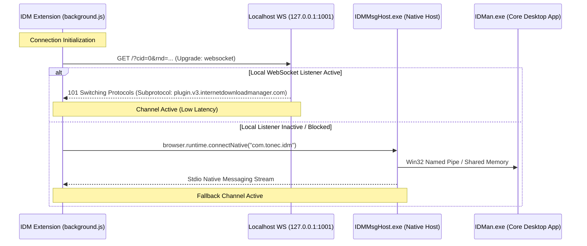
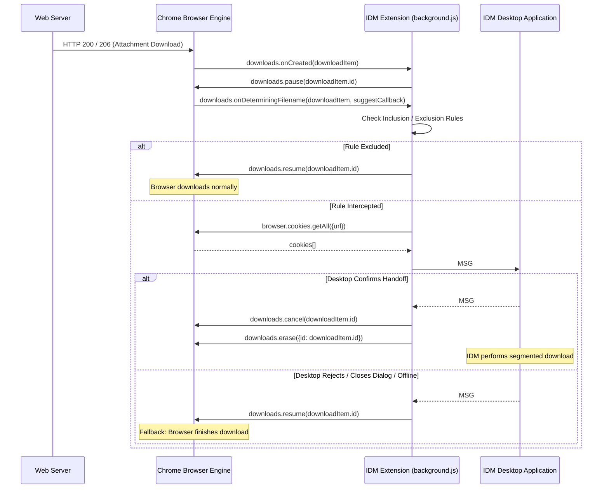

# 01 - IDM CRX Extension Analysis

**Document Status:** Complete Reverse-Engineering Analysis  
**Target:** IDM Integration Module (`NGPAMPAPPNMEPGILOJFOHADHHMBHLAEK_6_43_1_0.crx`)  
**Version:** `6.43.1` (Manifest V3)  
**Author:** Tonec FZE  
**Analysis Date:** 2026-10-30  
**SHA-256:** `1d2297ccbdbbf06e9e2546bb9f9b9985433eb7c02d75f09bbcbc9784ece583f7`  

---

## 1. Extension Manifest & Architecture Overview

The IDM browser extension is implemented as a Chromium Manifest V3 extension with fallback support for Firefox (WebExtension MV2):

```
research/extracted/crx/
├── manifest.json                  # Manifest V3 configuration
├── background.js                  # Background service worker (56 KB, obfuscated)
├── content.js                     # Content script injected at document_start (29 KB)
├── document.js                    # Web-accessible page-level script hooking fetch/XHR
├── debug.js                       # Web-accessible debug aid
├── captured.html / captured.js    # Captured media dialog
└── welcome.html / welcome.js      # Onboarding / tutorial page
```

### 1.1 Manifest Configuration
- **Manifest Version:** 3 (Chrome min version `109.0`).
- **Background Service Worker:** `background.js`.
- **Content Scripts:** `content.js` injected at `document_start` across all frames (`*://*/*`, `all_frames: true`).
- **Web Accessible Resources:** `document.js`, `debug.js`, `captured.js`, `captured.html` (accessible to `*://*/*`).
- **Declared Permissions:**
  - `scripting`, `tabs`, `cookies`, `contextMenus`, `webNavigation`, `webRequest`, `declarativeNetRequest`, `downloads`, `downloads.shelf`, `downloads.ui`, `management`, `storage`, `proxy`, `nativeMessaging`.
  - Optional: `notifications`, `system.display`.
  - Host permissions: `<all_urls>`.
  - Externally connectable: `*://*.internetdownloadmanager.com/*`, `*://*.tonec.com/*`.

---

## 2. Desktop IPC & Communication Mechanisms

### 2.1 Dual-Channel Transport Architecture
Contrary to common assumptions, IDM's browser extension does **not** rely solely on Chrome Native Messaging. It implements a dual-channel communication architecture:

1. **Localhost WebSocket (Primary Channel):**
   - Endpoints: `ws://127.0.0.1:1001/` and `ws://0.1.0.1:1001/`.
   - Subprotocol: `"plugin.v3.internetdownloadmanager.com"`.
   - Handshake URL: `ws://127.0.0.1:1001/?cid=<client_id>&rnd=<random_token>`.
   - Purpose: Direct, high-throughput, low-latency socket communication with the running IDM desktop instance without the overhead of spawning a sub-process for every browser tab or session.

2. **Native Messaging Host (Secondary / Fallback Channel):**
   - Host Name: `com.tonec.idm`.
   - Executable: `IDMMsgHost.exe`.
   - Dispatched via: `browser.runtime.connectNative("com.tonec.idm")`.
   - Lifecycle: If WebSocket connection attempts fail (`127.0.0.1:1001` closed or blocked), the extension connects via `connectNative`. The native host launches `IDMan.exe` or connects to IDM's internal IPC server.



### 2.2 Wire Framing and Message Protocol
IDM does **not** use JSON across its IPC boundary. Instead, it uses a proprietary ASCII/binary framing protocol:

$$\text{Framing Pattern:}\quad \texttt{MSG\#<seq>\#<type>\#<subType>\#<flags>[:arg1:arg2...][,tag=len:val...];}$$

- **Message Header (`MSG#`):**
  - `seq`: Monotonically incrementing integer sequence ID (`hb++`).
  - `type`: Integer message type identifier (e.g., `2` for handshake, `13` for download interception, `14` for manual download, `23` for media registration).
  - `subType`: Action code (e.g., `1`, `2`, `5`).
  - `flags`: Bitmask options.
- **Positional Arguments (`:arg`):**
  - Integer or float values separated by colons `:`.
- **Tagged Attributes (`,tag=val` or `,tag=len:val`):**
  - Attributes are formatted as `,tag=len:val` for strings and binary blobs, or `,tag=val` for scalars.
  - Semicolon `;` terminates the frame.

#### Discovered Tag Taxonomy
| Tag ID | Semantic Meaning | Observed Payload / Encoding |
|---|---|---|
| `[6]` | Target Download URL | Fully qualified URL string |
| `[17]` | Original / Redirected URL | Pre-redirect URL (when redirects occurred) |
| `[4]` | File Extension | Normalized lowercase file extension |
| `[100]` | Suggested Filename | Filename from browser or Content-Disposition |
| `[103]` | Total Bytes | Expected file size in bytes (`totalBytes`) |
| `[127]` | MIME Type | Response `Content-Type` header |
| `[8]` | Context / Interception Flags | Bitmask (e.g., `2048` for user-initiated, `4` for context menu) |
| `[50]` | Referrer URL | Document referrer or initiator URL |
| `[51]` | Primary Cookie Header | Extracted cookie string for target URL |
| `[56]` | Pre-Redirect Cookie Header | Extracted cookie string for original URL |
| `[54]` | User-Agent | Exact browser `navigator.userAgent` string |
| `[121]` / `[122]` | Extension / Browser Instance ID | Unique ID distinguishing active browser sessions |
| `[11]` | Forwarded Request Headers | Formatted list of request headers |
| `[12]` | HTTP Response Status Line | e.g., `"HTTP/1.1 200 OK"` |
| `[13]` | Forwarded Response Headers | Server response headers (`Content-Disposition`, `ETag`, etc.) |
| `[18]` | Trailing / Extra Headers | Additional HTTP metadata |

---

## 3. Download Interception Engine

IDM uses a multi-tiered interception strategy combining the `chrome.downloads` API with low-level `chrome.webRequest` monitoring:

### 3.1 Two-Stage Chrome Downloads Interception
1. **Immediate Pause on Creation (`downloads.onCreated`):**
   - Handler `n.qb` fires the instant a download task is registered.
   - It immediately calls `browser.downloads.pause(downloadId)` to halt network consumption before Chrome writes large chunks to disk.
   - Correlates the `downloadId` with pending HTTP request objects stored during `webRequest` lifecycle events.

2. **Determining Filename & Handshake (`downloads.onDeterminingFilename`):**
   - Handler `n.rb` intercepts the filename determination phase.
   - Evaluates URL, hostname, and file extension against user inclusion and exclusion regex rules:
     $$\text{Intercept if:}\quad \text{matches(inclusion)} \land \neg\text{matches(host\_exclusion)} \land \neg\text{matches(url\_exclusion)}$$
   - If excluded: immediately calls `kc(this, downloadId)`, which invokes `browser.downloads.resume(downloadId)` and releases the transfer to Chrome.
   - If intercepted:
     - Asynchronously fetches cookies for both `finalUrl` and original `url` via `browser.cookies.getAll()`.
     - Packages URL, headers, referrer, cookies, size, and suggested filename into a type `13` IPC frame:
       $$\texttt{MSG\#<seq>\#13\#1\#129:[id,0,timestamp,0,type,2],6=len:url,100=len:filename,50=len:ref,51=len:cookie,54=len:ua;}$$
     - Sets `item.Ka = true` to inform Chrome that filename determination is delayed asynchronously.
     - **On Desktop Acceptance:** Extension calls `browser.downloads.cancel(downloadId)` and `browser.downloads.erase({id: downloadId})`.
     - **On Desktop Rejection or Failure:** Extension calls `kc(this, downloadId)` which unpauses and resumes the browser download without user interruption.



---

## 4. Advanced Streaming Media Capture Architecture

IDM's media capture mechanism is significantly more sophisticated than simple extension MIME sniffing:

### 4.1 DOM-Level Mutation & Video Element Tracking (`content.js`)
- Injects a content script at `document_start` on every page and sub-frame.
- Uses `MutationObserver` to watch for added `<video>`, `<audio>`, `<object>`, and `<embed>` elements.
- Continuously calculates bounding boxes, screen visibility, and z-indexes of video elements to position the floating "Download this video" panel directly adjacent to the playing video.
- Inspects internal site framework objects:
  - Traverses React component state trees (e.g., `*.return.return.memoizedProps.coreVideoPlayerMetaData.videoFBID` for Facebook).
  - Inspects Vimeo player instances (`player.vimeo.com/video/<id>`).

### 4.2 In-Page API Hooking (`document.js`)
To capture dynamic streaming video where the manifest URL is never assigned to `<video src>` (e.g., MSE / MediaSource extensions with blob URLs `blob:http://...`), IDM injects `document.js` into the page's execution context:

1. **`window.fetch` Interception:**
   - Wraps `globalThis.fetch`.
   - Inspects outgoing URLs for manifest signatures (`.m3u8`, `.mpd`, `.f4m`, or custom site manifest patterns).
   - Injects custom tracking headers (`pxr-*`, `pfm-*`) to correlate request streams.
2. **`XMLHttpRequest` Interception:**
   - Hooks `XMLHttpRequest.prototype.open` and `send`.
3. **`Response.prototype` Chunk Sniffing:**
   - Hooks `Response.prototype.text`, `json`, `blob`, and `arrayBuffer`.
   - If a streaming manifest is loaded by a player script in the page, `document.js` inspects the response payload in memory and dispatches it back to `content.js` via `window.postMessage([1229212980, ...], "/")`.
   - `content.js` forwards the manifest URL, parsed stream bitrates, audio/video track pairs, and auth headers to `background.js` and onward to `IDMan.exe`.

---

## 5. Architectural Findings & Key Differences vs. qtIDM

| Capability | IDM Browser Extension (`6.43.1`) | qtIDM Browser Extension (`0.4.0`) | Architectural Significance |
|---|---|---|---|
| **IPC Transport** | Dual-channel: Localhost WebSocket (`ws://127.0.0.1:1001/`) + Native Messaging fallback. | Single-channel: Native Messaging host (`qtIDM-native-host`) forwarding over D-Bus. | WebSocket provides persistent, zero-spawn IPC for active sessions, but requires open local ports. D-Bus is more idiomatic on Linux. |
| **IPC Wire Format** | Custom compact text/binary protocol (`MSG#seq#type...;`). | Standard JSON (uint32 size + JSON payload). | JSON in qtIDM is human-readable, schema-validatable, and standards-compliant; IDM's compact format avoids JSON serialization overhead. |
| **Download Interception Hooks** | Two-stage: `onCreated` (immediate pause) + `onDeterminingFilename` (async rule validation and handoff). | `onCreated` (immediate pause + `prepareBrowserDownload` + handoff). | `onDeterminingFilename` provides Chrome's officially resolved disk collision filename before handoff. |
| **Cookie Collection** | Collects cookies for both `finalUrl` and original `url` across redirects. | Collects cookies for the target URL. | Capturing pre-redirect cookies improves authorization on multi-domain SSO downloads. |
| **In-Page API Hooking** | Injects `document.js` into page context to intercept `fetch`, `XHR`, and `Response` chunks. | Relies on `webRequest.onBeforeRequest` and `onHeadersReceived` extensions API. | Hooking in-page `fetch`/`XHR` captures manifests loaded into Blob URLs where `webRequest` lacks context. |
| **Video Element Sniffing** | Tracks DOM `<video>` coordinates, React state, and renders floating download buttons. | Popup-based media tab listing captured streams. | IDM displays an on-screen overlay button directly on the video player; qtIDM uses an action popup badge. |

---
*Analysis complete. Findings feed directly into Phase 4 (IDM Executable Analysis) and Phase 6 (Gap Analysis).*

