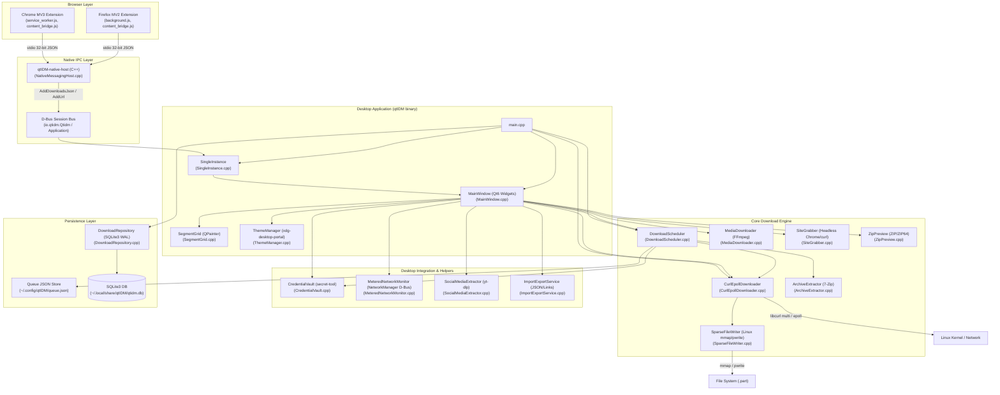

# 01 - qtIDM Baseline Architecture and Capability Analysis

**Document Status:** Complete Baseline  
**Project:** qtIDM  
**Target Environment:** Linux-native (x86_64), Qt 6.4+, C++20  
**Repository Branch:** `main` (commit `708395a`, tag `v0.2.3`)  
**Date:** 2026-10-30  

---

## 1. Executive Summary

qtIDM is an independently designed, Linux-native download manager written in C++20 using Qt6 Widgets. It implements segmented HTTP/HTTPS/FTP downloading with libcurl multi-interface coupled to Linux `epoll`, sparse `.part` file writing via sliding memory-mapped windows (`mmap`) with `pwrite` fallback, SQLite persistence in WAL mode, persistent queue scheduling, adaptive streaming media downloading (HLS and DASH via FFmpeg), and two-way browser integration (Chromium MV3 and Firefox MV2) via a dedicated Native Messaging Host communicating over Session D-Bus.

This baseline analysis reflects the local source code directly, documenting qtIDM's architectural foundations and capabilities.

---

## 2. Component Dependency Graph



---

## 3. Subsystem Architecture and Code Map

| Component | Source Files | Key Classes / Structs | Primary Responsibilities & Key Interfaces |
|---|---|---|---|
| **Entry Point & Lifecycle** | `src/main.cpp` | `main` | Initializes Qt application, installs `Logger`, registers Qt meta-types, manages single-instance lock via `SingleInstance`, loads database and scheduler, starts `CurlEpollDownloader` background thread, raises `MainWindow`. |
| **Single Instance & IPC** | `src/app/SingleInstance.h`, `.cpp` | `qtidm::SingleInstance` | Implements `io.qtidm.Qtidm.Application` on D-Bus session bus. Methods: `Activate()`, `AddUrl()`, `AddUrls()`, `AddDownloads()`, `AddDownloadsJson()`. |
| **Native Messaging Host** | `src/integration/NativeMessagingHost.cpp` | `qtIDM-native-host` | Standalone stdio binary for Chrome/Firefox. Reads 32-bit length-prefixed JSON, validates schemas, decodes base64 POST body (up to 4 MiB), launches `qtIDM` if needed (polling D-Bus up to 5s), forwards payloads over D-Bus. |
| **Download Engine** | `src/core/CurlEpollDownloader.h`, `.cpp` | `qtidm::CurlEpollDownloader`, `DownloadBatch`, `SegmentTransfer` | Background `std::jthread` event loop. Multi-interface curl with `epoll` and `eventfd`. Probes remote HTTP servers, performs Range scheduling, runs up to 32 concurrent segments per download, applies rate limits, monitors session data quotas, verifies checksums, atomically promotes `.part` to final file. |
| **Sparse File Writer** | `src/core/SparseFileWriter.h`, `.cpp` | `qtidm::SparseFileWriter` | Low-level file writer using Linux `open(..., O_CREAT | O_RDWR | O_CLOEXEC)`, `ftruncate` for sparse preallocation, 64 MiB sliding `mmap` window (`PROT_READ | PROT_WRITE, MAP_SHARED`) with `pwrite` fallback, and `fsync` on close. |
| **Download Scheduler & Queue** | `src/core/DownloadScheduler.h`, `.cpp` | `qtidm::DownloadScheduler` | Persistent multi-queue manager (`queue.json`). Dispatches tasks respecting queue concurrency, schedule timestamps, daily time windows (`windowStart`/`windowEnd`), and allowed weekdays. Triggers completion actions (file move, process execution, archive extraction). |
| **Persistence (SQLite)** | `src/storage/DownloadRepository.h`, `.cpp` | `qtidm::DownloadRepository` | SQLite3 storage (`qtidm.db`). WAL journal mode, `NORMAL` synchronous. Stores `downloads` and `segments` tables. Provides atomic upserts, status updates, segment offsets, and list restoration. |
| **Adaptive Media Engine** | `src/core/MediaDownloader.h`, `.cpp` | `qtidm::MediaDownloader` | Non-segmented streaming media downloader using FFmpeg. Detects HLS (`.m3u8`) and DASH (`.mpd`), refuses DRM (Widevine, PlayReady, FairPlay, SAMPLE-AES), forwards HTTP headers (cookies, referer, user agent). |
| **Archive Extraction** | `src/core/ArchiveExtractor.h`, `.cpp` | `qtidm::ArchiveExtractor` | Post-download archive handler. Invokes 7-Zip (`7zz` or `7z`). Analyzes archive listing to reject path traversal (`..`), absolute paths, and symlink/hardlink attacks before extracting to staging and promoting to destination. |
| **Site Grabber** | `src/core/SiteGrabber.h`, `.cpp` | `qtidm::SiteGrabber` | Recursive same-origin crawler. Supports optional headless Chrome/Chromium JavaScript rendering, DOM dumping, and extraction of `href`, `src`, and `srcset` links. |
| **ZIP Preview** | `src/core/ZipPreview.h`, `.cpp` | `qtidm::ZipPreview` | Parses classic ZIP and ZIP64 end-of-central-directory and central directory records directly from file without external dependencies. |
| **Credential Vault** | `src/integration/CredentialVault.h`, `.cpp` | `qtidm::CredentialVault` | Integrates with FreeDesktop Secret Service via `secret-tool`. Stores and retrieves HTTP basic/digest credentials by domain key without persisting cleartext passwords in request JSON. |
| **Metered Network** | `src/integration/MeteredNetworkMonitor.h`, `.cpp` | `qtidm::MeteredNetworkMonitor` | Queries NetworkManager via D-Bus (`org.freedesktop.NetworkManager`). Detects metered status (metered connection) and emits notifications to pause or hold active downloads. |
| **Social Media Extractor** | `src/integration/SocialMediaExtractor.h`, `.cpp` | `qtidm::SocialMediaExtractor` | Executes `yt-dlp --dump-json` to discover non-DRM media streams on supported platforms (Instagram, TikTok, Twitter/X, Reddit, Vimeo, Twitch, etc.). YouTube is explicitly excluded. |
| **User Interface** | `src/ui/MainWindow.h`, `.cpp` | `qtidm::MainWindow` | Main Qt6 Widgets window. Tables for downloads, tree for categories, filter bars, detailed properties tab, system tray integration, speed limit controls, and import/export actions. |
| **Segment Visualizer** | `src/ui/SegmentGrid.h`, `.cpp` | `qtidm::SegmentGrid` | Custom QWidget displaying segment chunks with proportional block colors (queued, downloading, completed) drawn via `QPainter`. |
| **Desktop Theme** | `src/theme/ThemeManager.h`, `.cpp` | `qtidm::ThemeManager` | Detects system light/dark theme via `org.freedesktop.portal.Settings` and updates UI styling dynamically. |
| **Browser Extensions** | `browser/chrome/*`, `browser/firefox/*` | Service Worker (MV3) / Background (MV2) | Intercepts downloads, listens to `webRequest` headers/POST data/response disposition, buffers media requests, captures context menus, communicates with `qtIDM-native-host`. |

---

## 4. Deep-Dive Analysis of Core Capabilities

### 4.1 Application Architecture
- **Framework & Standard:** C++20, Qt6 (Core, Gui, Widgets, DBus, Test).
- **Target OS:** Exclusively Linux (asserted in `CMakeLists.txt` with `if(NOT UNIX OR APPLE) message(FATAL_ERROR ...)`).
- **Process Model:**
  - Main UI application (`qtIDM`): single-instance process running Qt's `QApplication` event loop on the main thread and download engine on a dedicated thread.
  - Native Host (`qtIDM-native-host`): lightweight console binary spawned per browser extension session, delegating work to `qtIDM` via D-Bus.
  - External workers: spawned via `QProcess` for FFmpeg (media), 7-Zip (archives), `secret-tool` (passwords), `yt-dlp` (social extraction), and headless Chromium (site grabbing).

### 4.2 Download Engine & Event Loop Architecture
- **Concurrency Model:** Multi-threaded architecture:
  - Main thread: Qt Widgets UI, D-Bus signal/slot dispatching, scheduler dispatch timer.
  - Engine thread: `CurlEpollDownloader::run()` runs inside a dedicated `std::jthread`.
- **Event Multiplexing:**
  - Uses Linux `epoll` (`epoll_create1(EPOLL_CLOEXEC)`).
  - Integrates `eventfd` (`wakeFd_`) for instant, lock-free waking of the epoll wait loop when new transfers are enqueued or control commands (pause/cancel) arrive.
  - Combines `curl_multi_socket_action` with `epoll_ctl` (`EPOLLIN`, `EPOLLOUT`, `EPOLL_CTL_ADD`, `EPOLL_CTL_MOD`, `EPOLL_CTL_DEL`).
  - Timer integration: `CURLMOPT_TIMERFUNCTION` recalculates epoll wait timeout dynamically; expired libcurl timers call `curl_multi_socket_action(multi_, CURL_SOCKET_TIMEOUT, 0, ...)`.

### 4.3 HTTP Range Scheduling & Segment Allocation
- **Remote Probing:**
  - Before segmenting, `probeSize()` executes a HEAD or a 1-byte range GET request (`Range: bytes=0-0`).
  - Inspects HTTP response code (206 Partial Content vs 200 OK) to confirm server Range capability.
  - Captures `Content-Length`, `Content-Range`, `ETag`, and `Last-Modified`.
- **Dynamic Segment Splitting:**
  - Configurable segment count: clamped between 1 and 32 (default: 8).
  - Minimum dynamic part size: 64 KiB (`minimumDynamicPartSize = 64 * 1024`).
  - If total file size is known and dynamic segmentation is enabled:
    $$\text{dynamicParts} = \min\left(segments \times 4, \max\left(1, \frac{\text{total} + \text{partSize} - 1}{\text{partSize}}\right)\right)$$
    This partitions the file into a queue of smaller ranges.
  - Concurrency is throttled to `connectionLimit` (up to `segments`) and `perHostConnectionLimit` (up to 16 per domain).
  - As each segment finishes, `refillQueuedSegments()` immediately launches the next queued segment, keeping the connection pool fully saturated until all ranges are complete.
- **POST Requests:**
  - Handled as a special case: single connection, no Range probe, no multi-segment splitting, preserving POST request body.

### 4.4 File Writing & Disk Management
- **Sparse Allocation:**
  - Downloads write directly to a `.part` staging file in the target directory (`stagingPath = targetPath + ".part"`).
  - `ftruncate(fd, totalSize)` creates a sparse file without zero-filling the entire disk space immediately.
  - Pre-flight disk space verification: calls `QStorageInfo` to verify that `storage.bytesAvailable() >= additionalBytes`.
- **Sliding Window `mmap`:**
  - `SparseFileWriter` uses a 64 MiB window (`mapWindowSize = 64 * 1024 * 1024`).
  - Memory maps the aligned page offset (`PROT_READ | PROT_WRITE, MAP_SHARED`).
  - Direct `std::memcpy` into mapped memory for transfers within the mapped window.
  - If mapping fails or write span crosses boundaries, automatically falls back to thread-safe `::pwrite(fd, data, size, offset)`.
- **Atomic Promotion:**
  - Upon completion and integrity validation (checksum and segment completeness), `publishCompletedDownload()` atomically renames `target.part` to `target` using `QFile::rename`.

### 4.5 Persistence & Crash Recovery
- **Storage Backend:** SQLite 3 in WAL mode (`PRAGMA journal_mode=WAL; PRAGMA synchronous=NORMAL;`).
- **Database Path:** `~/.local/share/qtIDM/qtidm.db`.
- **Schema:**
  ```sql
  CREATE TABLE IF NOT EXISTS downloads (
      id TEXT PRIMARY KEY,
      url TEXT NOT NULL,
      target_path TEXT NOT NULL,
      category TEXT NOT NULL DEFAULT '',
      total_bytes INTEGER NOT NULL DEFAULT -1,
      completed_bytes INTEGER NOT NULL DEFAULT 0,
      status TEXT NOT NULL,
      created_at TEXT NOT NULL,
      updated_at TEXT NOT NULL,
      request_json TEXT NOT NULL DEFAULT '{}'
  );

  CREATE TABLE IF NOT EXISTS segments (
      download_id TEXT NOT NULL,
      segment_index INTEGER NOT NULL,
      range_start INTEGER NOT NULL,
      range_end INTEGER NOT NULL,
      written INTEGER NOT NULL DEFAULT 0,
      status TEXT NOT NULL,
      PRIMARY KEY(download_id, segment_index),
      FOREIGN KEY(download_id) REFERENCES downloads(id) ON DELETE CASCADE
  );
  ```
- **Resume Validation:**
  - Reads saved segments and offsets from SQLite.
  - Probes remote resource: checks `ETag` and `Last-Modified`. If entity tag or modification date has changed, rejects unsafe resume to prevent file corruption.
  - Range headers use `If-Range` with entity tag or last modified timestamp.
  - Verifies that existing `.part` file size is at least as large as the highest written segment offset.

### 4.6 Queue and Scheduling Architecture
- **Queue Manager:** `DownloadScheduler`.
- **Configuration File:** `~/.config/qtIDM/queue.json`.
- **Capabilities:**
  - Multiple named queues (default: `Main`).
  - Configurable queue concurrency limit (number of simultaneous downloads per queue).
  - Enable / Pause dispatch per queue without stopping running transfers.
  - Granular schedule constraints: `scheduledAt` timestamp, daily time windows (`windowStart` to `windowEnd`), allowed weekdays bitmask (`allowedWeekdays = 0x7f`).
  - Priority-based scheduling.
  - Automatic retry with exponential backoff on transient errors (base delay 500ms, max retries 5).
  - NetworkManager metered connection awareness: `HoldNew` (prevents starting new queued downloads) or `PauseActive` (pauses running transfers and restores them when unmetered).

### 4.7 Browser Integration & Native Messaging
- **Extension Implementations:**
  - Chrome / Chromium: Manifest V3 (`service_worker.js`, `content_bridge.js`, `popup.js`).
  - Firefox: Manifest V2 (`background.js`, `content_bridge.js`, `popup.js`).
- **Native Host:**
  - Executable: `qtIDM-native-host`.
  - Manifests: `io.qtidm.native.json` registered in `/etc/chromium/native-messaging-hosts/`, `/etc/opt/chrome/native-messaging-hosts/`, and `~/.mozilla/native-messaging-hosts/`.
  - Host protocol: standard WebExtension length-prefixed JSON (uint32 size + UTF-8 payload).
- **Communication Flow:**
  1. Browser download triggered (`chrome.downloads.onCreated`).
  2. Extension pauses browser download, queries `prepare` status from native host.
  3. Native host launches `qtIDM` if not running, waits for D-Bus interface.
  4. Extension sends full download descriptor to native host: URL, request headers (cookies, user-agent, referer, origin, sec-ch-*), HTTP method, base64 body, suggested filename.
  5. Extension cancels browser download and erases temporary entry. If qtIDM rejects or times out, extension unpauses/recreates browser download.
  6. Context menus: right-click single link/media, download all links/images in page, download selected text links (up to 100 links per batch).
  7. Media sniffing: intercepts network headers for HLS manifests (`.m3u8`), DASH manifests (`.mpd`), video/audio MIME types, and subtitles (`.vtt`, `.srt`), buffering candidates in per-tab storage.

---

## 5. Verification: Existing Automated Test Suite

A clean execution of the test suite (`ctest --test-dir build`) verified 17 passing test suites (2 skipped browser end-to-end tests due to lack of local Puppeteer/web-ext in test environment):

```
 1/19 Test  #1: qtIDM_core_tests ..................... Passed (0.05 s)
 2/19 Test  #2: qtIDM_download_types_tests ........... Passed (0.01 s)
 3/19 Test  #3: qtIDM_single_instance_tests .......... Passed (0.01 s)
 4/19 Test  #4: qtIDM_import_export_tests ............ Passed (0.03 s)
 5/19 Test  #5: qtIDM_sparse_file_writer_tests ....... Passed (0.01 s)
 6/19 Test  #6: qtIDM_site_grabber_tests ............. Passed (0.01 s)
 7/19 Test  #7: qtIDM_chrome_extension_e2e_tests ..... Skipped (Puppeteer not installed)
 8/19 Test  #8: qtIDM_firefox_extension_e2e_tests .... Skipped (web-ext not installed)
 9/19 Test  #9: qtIDM_browser_packaging_tests ........ Passed (0.94 s)
10/19 Test #10: qtIDM_scheduler_tests ................ Passed (0.02 s)
11/19 Test #11: qtIDM_archive_extractor_tests ........ Passed (0.06 s)
12/19 Test #12: qtIDM_credential_vault_tests ......... Passed (0.01 s)
13/19 Test #13: qtIDM_metered_network_tests .......... Passed (0.00 s)
14/19 Test #14: qtIDM_social_media_extractor_tests ... Passed (0.01 s)
15/19 Test #15: qtIDM_downloader_integration_tests ... Passed (5.32 s)
16/19 Test #16: qtIDM_media_downloader_tests ......... Passed (0.30 s)
17/19 Test #17: qtIDM_performance_smoke_tests ........ Passed (0.01 s)
18/19 Test #18: qtIDM_packaging_metadata_tests ....... Passed (0.01 s)
19/19 Test #19: qtIDM_zip_preview_tests .............. Passed (0.12 s)
```

---

## 6. Current Capabilities vs. Non-Capabilities vs. Uncertainties

### 6.1 What qtIDM Already Does
1. **High-concurrency segmented HTTP/HTTPS/FTP:** Up to 32 parallel connections with dynamic range refill.
2. **epoll-driven async I/O:** Zero-thread-per-connection architecture using `CURLM` and Linux `epoll`.
3. **Sparse file assembly:** Single `.part` file mapped via sliding 64 MiB `mmap` windows.
4. **Crash recovery & resume:** Verifies `ETag` and `Last-Modified` via `If-Range` headers before resuming; restores segment states from SQLite.
5. **Two-way browser integration:** Full context forwarding (cookies, referer, user agent, custom headers, POST body) for Chrome and Firefox.
6. **Graceful browser fallback:** Restores browser-native download if desktop handoff fails.
7. **Adaptive streaming media capture:** HLS/DASH manifest detection and FFmpeg execution.
8. **Security & sandbox isolation:** Path traversal / symlink rejection in 7-Zip extractor; Secret Service credential isolation.
9. **Linux desktop integration:** Portal theme tracking, NetworkManager metered network awareness, system tray, D-Bus activation.

### 6.2 What qtIDM Does Not Do (Out of Scope or Unimplemented)
1. **Windows API / Registry integration:** qtIDM is Linux-only; it does not use Windows registry, named pipes, or COM objects.
2. **Kernel network filter drivers:** qtIDM relies exclusively on browser extensions and standard userspace sockets without requiring kernel filter drivers.
3. **Separate per-connection temp files:** Rather than writing fragmented files and concatenating them, qtIDM writes directly into a single pre-allocated sparse `.part` file.
4. **BitTorrent downloading:** Intentionally excluded from project scope.
5. **DRM circumvention:** Explicitly refused (Widevine, PlayReady, FairPlay, SAMPLE-AES detected and rejected).
6. **Dynamic connection reallocation based on live throughput / slow connection reassignment:** qtIDM refills ranges when a part finishes, but does not split active stalled connections on the fly.
7. **HTTP/2 or HTTP/3 multiplexing tuning:** Current engine relies on libcurl standard multi-connection behavior without custom HTTP/2 stream prioritisation.

### 6.3 Technical Performance & Interoperability Questions
1. **Dynamic segment splitting:** What is the optimal threshold for splitting unread ranges when active connections finish early?
2. **Temporary file structure & assembly:** Does pre-allocating sparse files minimize disk fragmentation compared to segmented chunk staging?
3. **Browser communication channel:** How to best manage persistent native messaging without port congestion or IPC timeouts?
4. **Media sniffing mechanism:** How to reliably intercept media manifests and streams across varying Content-Security-Policy configurations?
5. **Browser download takeover decision logic:** What heuristics best prevent browser download interception from breaking inline web page navigation?
6. **Socket & TCP options:** What TCP buffer sizes and epoll event loops achieve highest throughput under high BDP networks?

---
*Baseline documentation recorded for multi-phase engine optimization.*

