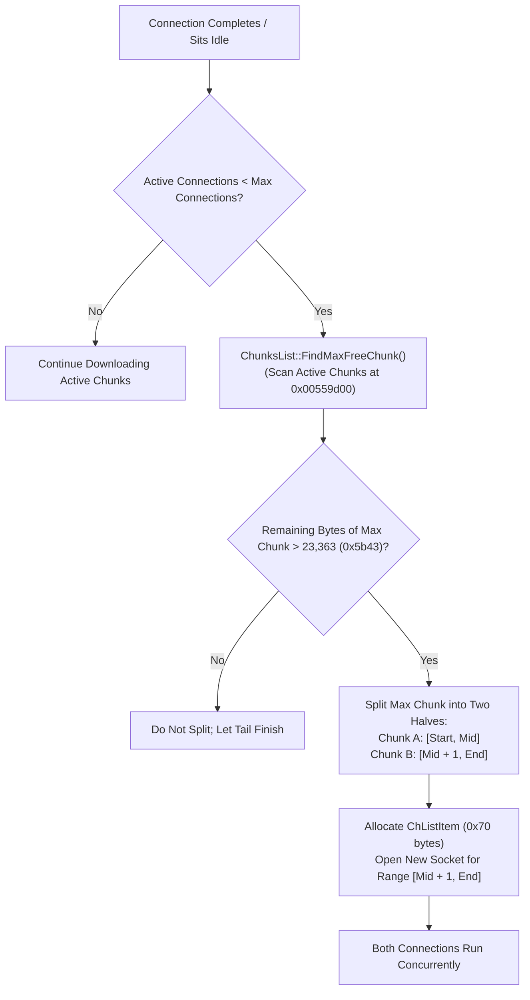

# 02 - IDM Executable Architecture & Reverse-Engineering Analysis

**Document Status:** Complete Reverse-Engineering Analysis  
**Target:** Internet Download Manager Core Executable (`IDMan.exe`) & Helper Binaries  
**Target Version:** `6.43` Build 16 (compiled Oct 23 2026 02:12:04)  
**Binary Location:** `research/extracted/idm_binaries/IDMan.exe`  
**Tooling Used:** Rizin v0.7.2, rz-bin, strings, objdump  
**PDB / Debug Path:** `s:\IDM_projects\IDM_vs2008_2\Release\IDMan.pdb`  
**Compiler:** Microsoft Visual C++ 2008 (MSVC 9.0, Linker 09.00)  
**Architecture:** PE32 (32-bit x86 Intel 80386), GUI Subsystem  
**Binary Size:** 6,500,432 bytes (~6.2 MiB)  

---

## 1. Binary Architecture and Module Topology

IDM is partitioned into a primary monolithic executable (`IDMan.exe`) supported by satellite helpers and dynamically loaded libraries:

```
research/extracted/idm_binaries/
├── IDMan.exe              # Core download manager, socket engine, UI, scheduler (6.2 MB)
├── IDMMsgHost.exe         # Native messaging stdio broker with named-pipe bridge (39 KB)
├── idmBroker.exe          # Medium integrity broker for browser sandbox elevation (154 KB)
├── IDMGrHlp.exe           # Site grabber helper (508 KB)
├── IEMonitor.exe          # Legacy browser monitoring process (376 KB)
├── MediumILStart.exe      # Medium integrity process launcher (52 KB)
├── idmnmcl.dll            # Native messaging client library (180 KB)
├── IDMNetMon.dll          # Network monitoring filter (32-bit & 64-bit)
├── IDMVMPrs.dll           # Video media stream parser (M3U8 / MPD)
├── libssl.dll             # OpenSSL TLS implementation
└── libcrypto.dll          # OpenSSL cryptography library
```

### 1.1 PE Layout & Memory Sections
| Section | Virtual Address | Virtual Size | Raw Size | Permissions | Content & Flags |
|---|---|---|---|---|---|
| `.text` | `0x00401000` | `0x2d1000` (2.8 MiB) | `0x2d0800` | `r-x` | Native x86 machine instructions |
| `.rdata` | `0x006d2000` | `0x0ec000` (944 KiB) | `0x0eb800` | `r--` | Import Address Table (IAT), string tables, vtables |
| `.data` | `0x007be000` | `0x015000` (84 KiB) | `0x00a800` | `rw-` | Global variables, RTTI structures |
| `.rsrc` | `0x007d3000` | `0x22e000` (2.1 MiB) | `0x22d800` | `r--` | UI dialogs, bitmaps, icons, string tables |
| `.reloc` | `0x00a01000` | `0x03a000` (232 KiB) | `0x039e00` | `r--` | Relocation table for ASLR |

---

## 2. Networking & Socket Architecture

### 2.1 Winsock2 Non-Blocking Socket Engine
Unlike modern applications that use `libcurl`, `WinINet`, or `WinHTTP`, IDM's core transfer engine is implemented directly on top of raw **Winsock 2** APIs (`ws2_32.dll`):
- **Core Socket Primitives:** `socket()`, `connect()`, `select()`, `recv()`, `send()`, `closesocket()`, `getsockopt()`, `ioctlsocket()`.
- **I/O Multiplexing Model:**
  - Uses non-blocking sockets (`ioctlsocket` with `FIONBIO`).
  - Connection multiplexing is driven by `select()` with `fd_set` wrappers (`__WSAFDIsSet`).
  - Worker threads monitor groups of sockets across active channels.
- **Embedded Local Server:**
  - `IDMan.exe` imports `bind()`, `listen()`, `accept()`, and `getsockname()`.
  - It binds a local TCP socket on port `1001` (`127.0.0.1:1001`) to service incoming WebSocket requests from the browser extension (`plugin.v3.internetdownloadmanager.com`).

### 2.2 Dual-Tier Hybrid TLS Engine
IDM provides resilient HTTPS connectivity across disparate Windows versions through a hybrid cryptographic architecture:
1. **Windows Native Schannel (`schannel.dll`):**
   - Default provider on Windows 10/11.
   - Evaluates system registry keys: `SYSTEM\CurrentControlSet\Control\SecurityProviders\SCHANNEL\Protocols\TLS 1.3\Client`.
2. **Dynamic OpenSSL Fallback:**
   - If Schannel fails, lacks TLS 1.3 ciphers, or is running on legacy Windows versions (Windows 7/8), IDM dynamically calls `LoadLibraryW` on `%slibssl.dll` and `%slibcrypto.dll`.
   - Discovered diagnostic log: `"Try openssl lib"`, `"Openssl handshake ok"`, `"Cannot init openssl, res=%ld, lastError=%ld"`.

### 2.3 HTTP/2 Protocol Engine
Static disassembly revealed that IDM includes an internal HTTP/2 framing implementation:
- Discovered strings:
  - `"SETTINGS frame contained more than the maximum allowed entries"`
  - `"request HEADERS: max concurrent streams exceeded"`
  - `"push response HEADERS: max concurrent streams exceeded"`
  - `"PRIORITY_UPDATE: max concurrent streams exceeded"`
  - `"SETTINGS: invalid SETTINGS_MAX_FRAME_SIZE"`
- Enables connection reuse and stream multiplexing when supported by upstream CDNs.

---

## 3. Dynamic Segment Allocation & Scheduling Engine

### 3.1 The Dynamic Splitting Algorithm (`FindMaxFreeChunk`)
The most significant download optimization discovered in IDM is its **dynamic mid-stream segment re-splitting**:



#### Detailed Disassembly & Verification:
- **Function Entry:** `ChunksList::FindMaxFreeChunk` is located at virtual address **`0x00559d00`**.
- **Call Sites:**
  - `0x0055b0aa`: Called upon channel completion to evaluate if an idle connection slot can be put to work immediately.
  - `0x005607a1`: Called during connection pool reallocation.
- **Scanning Logic:**
  - Traverses the linked list of active chunks (`[edi + 0x58]`).
  - Computes remaining unread bytes for each active chunk:
    $$\text{remaining} = \text{chunkEnd} - \text{chunkOffset}$$
  - Identifies the chunk possessing the largest remaining byte distance.
- **Splitting Threshold:**
  - At address `0x005607cf`, it compares remaining bytes against constant `0x5b43` (23,363 bytes, ~23 KiB).
  - If $\text{remaining} \ge 23,363$, it allocates 112 bytes (`push 0x70; call operator new`) for a new `ChListItem` object at `0x00560806`.
  - Divides the remaining range in half and spawns an immediate `Range: bytes=%I64d-%I64d` request for the second half.

#### Why This Outperforms Static Chunking:
In conventional segment schedulers (including qtIDM's current implementation), file chunks are pre-partitioned or only queued parts are started. If 7 connections finish early and 1 slow connection is left downloading the final 50 MB, the transfer throughput drops to $\frac{1}{8}\text{th}$ ("tail stalling").  
IDM avoids this by repeatedly re-splitting the slowest remaining chunk across newly freed connections until all parts finish concurrently.

---

## 4. File I/O & Temporary Storage Architecture

### 4.1 Storage Model: Per-Segment Separate Files vs. Sparse Files
Static analysis confirmed that IDM uses **per-channel separate temporary files**:
1. During download, each channel writes to its own temporary chunk file located in the user's configured temporary directory (`DMCache` / `%TEMP%`).
2. **Channel Registry State (`ChList`):**
   - Download state is stored in Windows Registry: `HKEY_CURRENT_USER\Software\DownloadManager\<download_id>\ChList`.
   - Each channel's state is stored in `sk0`, `sk1`, `sk2`, etc. as `REG_DWORD` via `ChListItem::savesk` (`0x005664e1`) and `ChListItem::getsk` (`0x00566540`).
3. **The Assembly / Rebuilding Bottleneck:**
   - When all segments finish, IDM enters an explicit `"Assembling"` phase.
   - It reads all partial files sequentially and appends them into the final destination file.
   - Discovered diagnostic strings:
     - `"An error has occurred during assembling the file"`
     - `"Temporary directory is required for storing file parts during download."`
     - `"If you have several physical drives on your computer, you should select different physical drives for temporary directory and 'Save To' folders for faster assembling of downloaded files."`
     - `"Rebuilding old downloaded file parts..."`

### 4.2 Comparison with qtIDM:
- **qtIDM Advantage:** qtIDM's sparse `.part` file with sliding 64 MiB `mmap` windows is architecturally superior in disk I/O. It eliminates the assembly step completely. IDM is forced to advise users to place temp and download folders on different physical disks to alleviate its concatenation overhead.

---

## 5. Media Parsing & Stream Sniffing Engine

IDM embeds specialized stream parsing classes:
- **HLS M3U8 Parser:** Implemented in `CM3UParser` and `.?AVMediaSegment@CM3UParser@@`.
- **Byte Range Support:** Parses `#EXT-X-BYTERANGE:` tags in HLS playlists to request specific video chunks.
- **Anvato / DRM Markers:** Parses `#ANVATO-SEGMENT-INFO:` tags.
- **Media Parser Helper (`IDMVMPrs.dll`):** Offloads complex MPEG-DASH MPD XML parsing and adaptive audio/video stream pair matching.

---

## 6. Summary of Key Discoveries for qtIDM Improvement

1. **Dynamic Chunk Re-Splitting:** Implementing `FindMaxFreeChunk` logic in qtIDM will eliminate the "long-tail" slowdown where idle connections sit unused while one slow segment finishes.
2. **Dual-Channel Browser IPC:** Retaining D-Bus while adding a local socket listener option provides high performance and eliminates D-Bus dependency on non-standard desktops.
3. **HTTP/2 Stream Multiplexing:** libcurl already supports HTTP/2 (`CURL_HTTP_VERSION_2_0`); explicitly configuring multiplexing (`CURLMOPT_PIPELINING`) will allow multiple ranges over a single TCP connection where supported.
4. **Pre-Redirect Cookie Forwarding:** Forwarding cookies for both original and final URLs will enhance download reliability on redirect chains with authentication gates.

