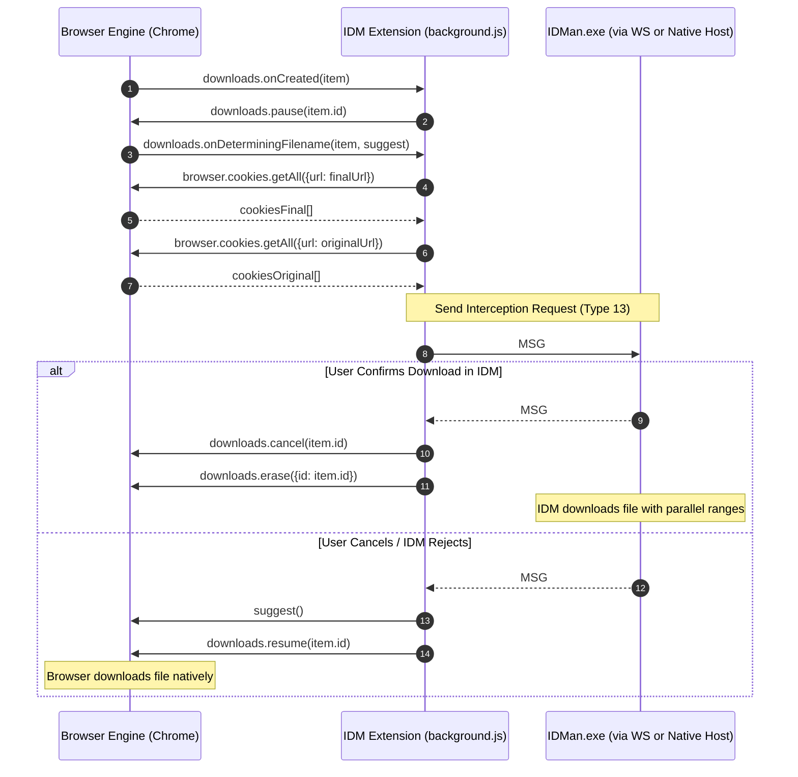

# 03 - IDM Browser Integration Protocol Specification

**Document Status:** Complete Reverse-Engineered Protocol Specification  
**Components:** IDM Extension (`NGPAMPAPPNMEPGILOJFOHADHHMBHLAEK`) $\longleftrightarrow$ `IDMMsgHost.exe` / `IDMan.exe`  
**Date:** 2026-10-30  
**Transport Types:** WebExtension Native Messaging (`stdio`) & Localhost WebSocket (`ws://127.0.0.1:1001/`)  

---

## 1. Transport Channels and Connection Lifecycle

IDM implements two complementary transport mechanisms:

```mermaid
flowchart LR
    subgraph Browser ["Chrome / Chromium / Edge / Firefox"]
        Ext["IDM Integration Module\n(background.js)"]
    end

    subgraph Channel1 ["Transport Channel 1 (Primary)"]
        WS["WebSocket Client\n(plugin.v3.internetdownloadmanager.com)"]
        TCP["Local TCP Listener\n(127.0.0.1:1001)"]
    end

    subgraph Channel2 ["Transport Channel 2 (Secondary Fallback)"]
        NM["chrome.runtime.connectNative\n(com.tonec.idm)"]
        Host["IDMMsgHost.exe\n(Stdio Native Host)"]
        Pipe["Win32 Named Pipe\n(\\pipe\\idm_...)"]
    end

    subgraph Desktop ["IDM Core Application"]
        Core["IDMan.exe\n(Download Engine & Message Router)"]
    end

    Ext -->|Attempt 1| WS
    WS <-->|ws://127.0.0.1:1001/| TCP
    TCP <--> Core

    Ext -.->|Attempt 2 Fallback| NM
    NM <-->|Stdio (32-bit len)| Host
    Host <-->|Overlapped I/O| Pipe
    Pipe <--> Core
```

### 1.1 WebSocket Handshake (Channel 1)
- **URL Pattern:** `ws://127.0.0.1:1001/?cid=<client_id>&rnd=<random_token>` (and backup `ws://0.1.0.1:1001/`).
- **Subprotocol:** `"plugin.v3.internetdownloadmanager.com"`.
- **Framing:** WebSocket text and binary frames encapsulating the ASCII wire protocol.
- **Heartbeat:** 15-second keepalive timer (`this.Ma` with `S(this, 0, 1, 1)`).

### 1.2 Native Messaging Handshake (Channel 2)
- **Host Registration:** `com.tonec.idm` registered under `HKCU\Software\Google\Chrome\NativeMessagingHosts\com.tonec.idm` and `HKCU\Software\Mozilla\NativeMessagingHosts\com.tonec.idm`.
- **Stdio Framing:** 32-bit little-endian integer message length followed by the ASCII message string.
- **Pipe Bridge:** `IDMMsgHost.exe` bridges the browser's stdio stream directly to IDM's internal Win32 named pipe using overlapped asynchronous I/O (`ReadFile`/`WriteFile`).

---

## 2. Wire Framing and Protocol Grammar

Whether transmitted over WebSocket or Native Messaging, messages share an identical proprietary framing syntax.

### 2.1 EBNF Grammar
```ebnf
Message        ::= "MSG#" Sequence "#" Type "#" SubType "#" Flags [ PositionalArgs ] [ TaggedMap ] ";"
Sequence       ::= Integer
Type           ::= Integer
SubType        ::= Integer
Flags          ::= Integer
PositionalArgs ::= ( ":" Value )*
TaggedMap      ::= ( "," Tag "=" TagValue )*
Tag            ::= Integer
TagValue       ::= ScalarValue | SizedString | BinaryPayload
ScalarValue    ::= Integer | Float
SizedString    ::= Length ":" StringContent
BinaryPayload  ::= Length "%" Base64Content
```

### 2.2 Standard Message Types
| Type ID | SubType | Name / Function | Direction | Description |
|---|---|---|---|---|
| `2` | `5` | `HANDSHAKE_INIT` | Ext $\to$ App | Extension registers version, language, browser ID. |
| `0` | `1` | `HEARTBEAT` | Both | Periodic 15-second keepalive ping/pong. |
| `10` | `1` | `MEDIA_BUTTON_POS` | Ext $\to$ App | Floating video download button coordinates. |
| `11` | `*` | `FRAME_REGISTER` | Ext $\to$ App | Registers tab/frame navigation context. |
| `13` | `1` | `DOWNLOAD_INTERCEPT` | Ext $\to$ App | Submits intercepted browser download. |
| `13` | `2` | `DOWNLOAD_DECISION` | App $\to$ Ext | Desktop accepts or rejects intercepted download. |
| `14` | `1` | `MANUAL_DOWNLOAD` | Ext $\to$ App | Submits context menu / single link download. |
| `15` | `1` | `BATCH_DOWNLOAD` | Ext $\to$ App | Submits batch link array. |
| `23` | `2` | `MEDIA_DETECTED` | Ext $\to$ App | Registers newly sniffed video/audio stream. |

---

## 3. Tag Field Taxonomy

The tagged attribute map uses integer identifiers to serialize request and response attributes without key strings:

| Tag | Field Name | Data Type | Description |
|---|---|---|---|
| `2` | `contextId` | Integer | Internal browsing context ID |
| `4` | `fileExtension` | String | Extracted file extension (lowercase) |
| `6` | `targetUrl` | String | The resolved destination download URL |
| `7` | `pageUrl` | String | Top-level document URL of the hosting page |
| `8` | `interceptionFlags`| Integer | Bitmask (2048: user-triggered, 4: context-menu) |
| `11`| `requestHeaders` | Sized String | Forwarded HTTP request headers |
| `12`| `responseStatus` | String | HTTP response status line (e.g. `HTTP/1.1 200 OK`) |
| `13`| `responseHeaders`| Sized String | Server response headers (ETag, Content-Disposition) |
| `17`| `originalUrl` | String | Pre-redirect URL (before 301/302/307 redirects) |
| `18`| `extraHeaders` | Sized String | Trailing / custom browser headers |
| `31`| `initiatorOrigin`| String | Security origin of the request initiator |
| `50`| `referrerUrl` | String | HTTP Referer header string |
| `51`| `cookieString` | String | Cookie header for the target URL |
| `54`| `userAgent` | String | Exact browser `navigator.userAgent` string |
| `56`| `preRedirectCookie`| String | Cookie header for the pre-redirect URL |
| `100`| `suggestedFilename`| String | Suggested filename from browser or Content-Disposition |
| `103`| `totalBytes` | Integer | Anticipated file size in bytes |
| `110`| `batchTitle` | String | Name of the batch or page title |
| `121`| `firefoxInstanceId`| Integer | Browser session ID for Firefox |
| `122`| `chromeInstanceId`| Integer | Browser session ID for Chrome/Chromium |
| `127`| `mimeType` | String | Server `Content-Type` header |
| `132`| `mediaBitrate` | Integer | Video/audio bitrate in bps |
| `133`| `mediaFormat` | String | Stream container format (e.g., MP4, M3U8, WEBM) |
| `134`| `mediaResolution`| String | Video resolution (e.g., `1920x1080`) |

---

## 4. End-to-End Interception Sequence Flow

The following sequence illustrates the complete message exchange during a download handoff:



---

## 5. Architectural Evaluation for qtIDM

1. **Protocol Design:** IDM's integer-tagged ASCII framing is extremely compact and avoids parsing overhead, but is completely proprietary. qtIDM's JSON-based protocol is standards-compliant, human-readable, and supported out-of-the-box by WebExtensions.
2. **Dual-Cookie Forwarding:** IDM captures cookies for both the initial URL and final target URL across redirects. qtIDM should adopt this practice to handle OAuth/SSO redirects where initial authorization cookies differ from CDN download cookies.
3. **Transport Channel:** Localhost WebSocket eliminates process-spawning overhead. While D-Bus is the gold standard on Linux desktops, providing an optional localhost WebSocket or UNIX domain socket listener would allow headless or containerized environments to integrate cleanly.

