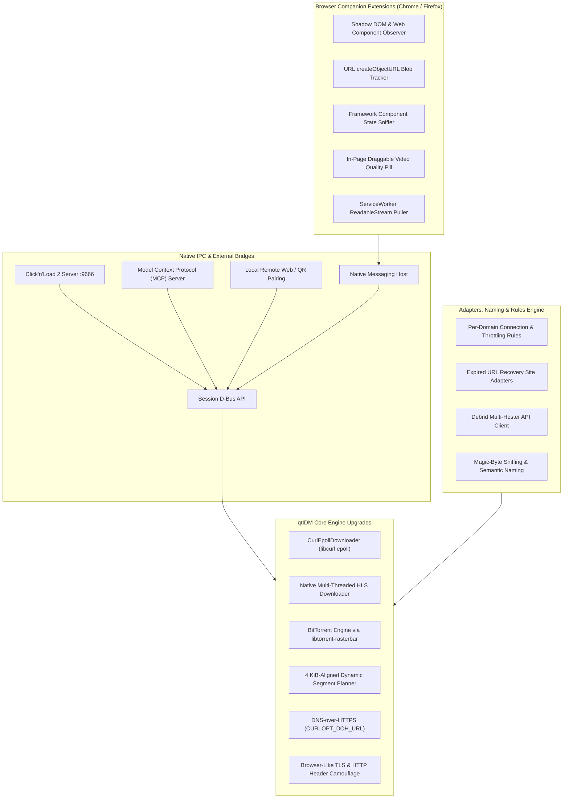

# 08 - Architectural Enhancement Roadmap

This document specifies clean-room architectural enhancements for **qtIDM** across four tracks: Core Engine & Protocol Capabilities, Browser Integration & Media Sniffing, Power-User & Ecosystem Integrations, and Network Resilience, Naming & Site Adapters. All implemented items are built independently from open web standards (RFC 7230, RFC 7233, RFC 6265, RFC 7540, RFC 8216, RFC 8484) and standard Linux desktop / browser Native Messaging APIs.

---

## 1. High-Level Architecture

---

## 2. Feature Inventory & Delivery Status

### Category A: Core Engine & Protocol Capabilities

#### A1. Native Multi-Threaded HLS/M3U8 Chunk Downloader `[STATUS: COMPLETED]`
- **Delivered in qtIDM**:
  1. [`HlsPlaylistParser`](../src/core/HlsPlaylistParser.cpp): RFC 8216-compliant parser supporting multivariant playlists, variant selection by resolution and bandwidth, media playlists (`#EXTINF`, `#EXT-X-TARGETDURATION`, `#EXT-X-MEDIA-SEQUENCE`, `#EXT-X-BYTERANGE`), fMP4 init segments (`#EXT-X-MAP`), separate audio renditions (`#EXT-X-MEDIA:TYPE=AUDIO`), and OpenSSL 3.0 EVP AES-128-CBC segment decryption (`decryptAes128Cbc`).
  2. [`HlsDownloader`](../src/core/HlsDownloader.cpp): Work-stealing persistent worker pool (`std::vector<std::jthread>`, `std::condition_variable`) downloading video and audio segments concurrently over libcurl without synchronous batch stalls.
  3. Key rotation support: Thread-safe multi-key cache (`QHash<QUrl, QByteArray>`) supporting independent encryption keys across segments.
  4. Dual-stream downloading & muxing: Automatically fetches separate audio streams when declared in the master playlist and multiplexes them locally via FFmpeg (`-c copy -movflags +faststart`).
  5. Live segment visualization: Emits `segmentsChanged(id, segments)`, wired through [`MediaDownloader`](../src/core/MediaDownloader.cpp) and [`MainWindow`](../src/ui/MainWindow.cpp) into [`SegmentGrid`](../src/ui/SegmentGrid.cpp).
  6. Verification: [`tests/HlsPlaylistParserTest.cpp`](../tests/HlsPlaylistParserTest.cpp) (`qtIDM_hls_parser_tests`) and [`tests/HlsDownloaderTest.cpp`](../tests/HlsDownloaderTest.cpp) (`qtIDM_hls_downloader_tests`).

#### A2. Native BitTorrent & Magnet Link Engine `[STATUS: PENDING]`
- **Current Limitation**: qtIDM currently supports HTTP, HTTPS, FTP, and HLS/DASH media streams.
- **Target Implementation**:
  1. Link `libtorrent-rasterbar` in [`CMakeLists.txt`](../CMakeLists.txt).
  2. Implement `TorrentDownloader` in `src/core/` matching the signal interface (`downloadAdded`, `progressChanged`, `statusChanged`) of `CurlEpollDownloader`.
  3. Support magnet link parsing, `.torrent` file selection, DHT/PEX, and sequential piece downloading.
  4. Connect piece bitfields to [`SegmentGrid.cpp`](../src/ui/SegmentGrid.cpp).

#### A3. DNS-over-HTTPS (DoH) & Custom DNS Resolver `[STATUS: COMPLETED]`
- **Delivered in qtIDM**:
  1. Configurable DoH presets (`Cloudflare`, `Google`, `Quad9`, `AdGuard`, `OpenDNS`, `Cloudflare Security`, and `Custom URL`) in [`DownloadTypes.h`](../src/core/DownloadTypes.h) / [`DownloadTypes.cpp`](../src/core/DownloadTypes.cpp).
  2. Integrated into [`CurlEpollDownloader.cpp`](../src/core/CurlEpollDownloader.cpp) via `CURLOPT_DOH_URL`, `CURLOPT_DOH_SSL_VERIFYPEER`, and `CURLOPT_DOH_SSL_VERIFYHOST`.
  3. Probe worker IP pinning & SSRF protection: resolves via DoH, pins public IPs using `CURLOPT_RESOLVE`, and blocks private/loopback DNS rebinding.
  4. Exposed in the Application Options dialog with persistence across restarts and wired into [`MediaStreamProxy.cpp`](../src/core/MediaStreamProxy.cpp) and [`HlsDownloader.cpp`](../src/core/HlsDownloader.cpp).

#### A4. Dynamic Segment Boundary Alignment & Stealing Planner `[STATUS: COMPLETED]`
- **Delivered in qtIDM**:
  1. **Pure C++20 [`SegmentPlanner`](../src/core/SegmentPlanner.cpp)**:
     - **4 KiB Block Alignment (`kPageAlign = 4096`)**: `planInitialSegments()` aligns every internal segment start to a 4096-byte page boundary (eliminating false kernel page sharing across parallel `mmap` windows), and `computeAlignedSplitPoint()` rounds dynamic split midpoints to 4096-byte boundaries while guaranteeing both halves remain `>= minSplitBytes`.
     - **Two-Phase Range Locking (`claim` / `commit` / `abortClaim`)**: Separates durably written `[start, cursor)` from in-flight claimed `[cursor, reserved)` bytes so dynamic splits never cut into active disk writes.
     - **Priority Work Assignment & Preemption (`assign`)**: Prefers contiguous continuation, preempts stalled pending connections (`!receiving && elapsed >= preemptAfterMs`, calibrated adaptively via EWMA TTFB), and steals the upper half of the slowest remaining segment at a 4 KiB boundary.
     - **Save/Resume Validation**: `save()` / `resume()` validates exact gapless, non-overlapping tiling of `[0, totalSize)`.
  2. **Engine Integration**: Wired into [`CurlEpollDownloader.cpp`](../src/core/CurlEpollDownloader.cpp) (`writeCallback`, `splitActiveSegment`, `preemptStalledSegment`) with HTTP/1.1 fallback on preempted connections and SQLite crash-safe split persistence.
  3. **Verification**: [`tests/SegmentPlannerTest.cpp`](../tests/SegmentPlannerTest.cpp) (`qtIDM_segment_planner_tests`, 9/9 passing) and real HTTP split alignment assertions in [`tests/DownloaderIntegrationTest.cpp`](../tests/DownloaderIntegrationTest.cpp).

---

### Category B: Browser Integration & Media Sniffing

#### B1. Blob & Object URL Interception `[STATUS: COMPLETED]`
- **Delivered in qtIDM**:
  1. **In-Page Hook ([`browser/chrome/content_bridge.js`](../browser/chrome/content_bridge.js) & [`browser/firefox/content_bridge.js`](../browser/firefox/content_bridge.js))**:
     - Wraps `URL.createObjectURL` and `URL.revokeObjectURL` with native `toString()` masking, captures programmatically triggered `<a download>` blob clicks, distinguishes MSE `MediaSource` streams from discrete `Blob`/`File` downloads, and retains blobs in a dual-bounded LRU cache (`MAX_BLOBS = 25`, `MAX_TOTAL_BYTES = 100 MiB`) to recover from immediate webpage revocation.
  2. **Multi-Tier Download Fallback ([`browser/chrome/service_worker.js`](../browser/chrome/service_worker.js) & [`browser/firefox/background.js`](../browser/firefox/background.js))**:
     - Direct `downloads.download`, automatic `refreshBlobUrl` revocation recovery, and same-origin `downloadBlobInPage` fallback when storage partitioning restricts background fetches.
  3. **Metadata Sniffing & UI**: Classifies video, audio, document, archive, and image blobs while filtering ephemeral noise; renders formatted byte sizes and hostnames in [`popup.js`](../browser/chrome/popup.js).

#### B2. Shadow DOM & Web Component Traversal `[STATUS: COMPLETED]`
- **Delivered in qtIDM**:
  1. Wraps `Element.prototype.attachShadow` and `Element.prototype.setHTMLUnsafe` to enroll both `"open"` and `"closed"` shadow roots into a `WeakSet`-tracked shared `MutationObserver` while preserving closed encapsulation (`host.shadowRoot === null`).
  2. Attaches capture-phase media listeners (`play`, `playing`, `loadedmetadata`, `canplay`) and recursively traverses nested Shadow Roots (up to `MAX_SHADOW_DEPTH = 12`), including Declarative Shadow DOM (`<template shadowrootmode="open">`).
  3. Provides a zero-duplication Main-World/Isolated-World handshake, automatic Isolated-World open Shadow DOM fallback on strict-CSP pages, and `event.composedPath()` click handling.

#### B3. Framework Component State Sniffing (`window.__qtidm_component_sniffer`) `[STATUS: COMPLETED]`
- **Delivered in qtIDM**:
  1. Introspects React 16–19 (`__reactFiber$`, `__reactInternalInstance$`, `__reactProps$`, Hooks lists), Vue 2 & Vue 3 (`__vue__`, `__vueParentComponent`, `__vnode`, `ref()`/`computed()`), Preact, Svelte (`__svelte`), Angular Ivy (`__ngContext__`), `dataset` attributes, and attached player SDK references across `ShadowRoot.host` boundaries.
  2. Resolves extensionless signed CDN URLs via dedicated media keys and sibling `type`/`mimeType` metadata, filters thumbnails/ads/SSRF/invalid schemes, ranks discoveries (`HLS` > `DASH` > `Video` > `Audio` > `Subtitle`), and enforces strict object-graph traversal budgets with O(1) cycle detection.
  3. Fixed pre-existing double-escaped regex literals in Main-World `fetch` and `XMLHttpRequest` manifest hooks.

#### B4. Cross-Origin Iframe Agent & Frame Bridge `[STATUS: COMPLETED]`
- **Delivered in qtIDM**:
  1. Enabled `"match_about_blank": true` in both [`browser/chrome/manifest.json`](../browser/chrome/manifest.json) and [`browser/firefox/manifest.json`](../browser/firefox/manifest.json) (plus `"match_origin_as_fallback": true` in Chrome MV3).
  2. Added versioned `postMessage` bridging (`source: "qtidm-frame-bridge", version: 1`) from child frames to a bounded top-window `frameRegistry` (`MAX_TRACKED_FRAMES = 40`, `MAX_MEDIA_PER_FRAME = 25`) with strict SSRF/origin validation, `topFrameReady` replay, and `pagehide` unload cleanup.
  3. Added frame-scoped `blob:` refresh/download targeting (`{ frameId }`), iframe `Referer`/`Origin` preservation, dead `blob:` pruning on `frameUnloaded`, and `iframe` badges in extension popups.

#### B5. In-Page Draggable Video Quality Pill `[STATUS: PENDING]`
- **Current Limitation**: Captures are surfaced in the browser toolbar extension popup.
- **Target Implementation**:
  1. Display a discrete floating overlay pill on active `<video>` elements on hover.
  2. Display detected stream qualities (`1080p`, `4K`, `Audio`) and send downloads directly to qtIDM via Native Messaging.
  3. Allow dragging to any corner with per-domain offset persistence.

#### B6. ServiceWorker Stream Puller `[STATUS: COMPLETED]`
- **Delivered in qtIDM**:
  1. **Main-World `ReadableStream` Slicer (`window.__qtidm_sw_puller`)**: Verifies active `navigator.serviceWorker.controller` and same-origin scope, fetches via the original `fetch` (`credentials: "include"`, `mode: "same-origin"`, `cache: "no-store"`, `redirect: "error"`), and pulls 32 KiB (`32768`-byte) base64 chunks under strict in-order backpressure with a 4-session concurrency cap.
  2. **Background Orchestrator**: `pullServiceWorkerStream` streams chunks over Native Messaging (`swStreamBegin` -> `swStreamChunk` -> `swStreamFinish`) with automatic `swRelease` / `swStreamAbort` cleanup on errors, integrated into `redirectBrowserDownload`.
  3. **Native Host Stream Receiver ([`SwStreamSessionManager`](../src/integration/SwStreamSessionManager.cpp), [`NativeMessagingHost.cpp`](../src/integration/NativeMessagingHost.cpp))**: Writes chunks directly into `SparseFileWriter` with atomic `.qtidm-part` promotion, filename sanitization, collision-safe numbering, sequence/offset verification, strict base64 validation, and disconnect cleanup.
  4. **Verification**: [`tests/SwStreamSessionManagerTest.cpp`](../tests/SwStreamSessionManagerTest.cpp) (`qtIDM_sw_stream_tests`, 7/7 passing) and VM/background tests in [`tests/browser_interception_test.cjs`](../tests/browser_interception_test.cjs).

---

### Category C: Power-User & Ecosystem Integrations

#### C1. Click'n'Load 2 (CNL2) Local Server `[STATUS: PENDING]`
- **Target Implementation**:
  1. Add `ClickAndLoadServer` in `src/integration/` listening on `127.0.0.1:9666`.
  2. Handle `POST /flash/addcrypted2` (AES-128-CBC decrypt with key from `jk`) and `POST /flash/add`.
  3. Extract decrypted URLs, package names, and passwords and open the Batch Download dialog.

#### C2. Debrid Multi-Hoster Integration `[STATUS: PENDING]`
- **Target Implementation**:
  1. Add `DebridService` in `src/integration/` supporting Real-Debrid, AllDebrid, Premiumize, and TorBox.
  2. Store API tokens securely in [`CredentialVault.cpp`](../src/integration/CredentialVault.cpp) (`secret-tool`).
  3. Unrestrict supported hoster links via official APIs and download the direct CDN stream.

#### C3. Model Context Protocol (MCP) Server for AI Agents `[STATUS: PENDING]`
- **Target Implementation**:
  1. Add an MCP server (`qtidm-mcp` or `qtidm-cli mcp`) speaking stdio JSON-RPC 2.0 over the session D-Bus automation interface (`io.qtidm.Qtidm`).
  2. Expose tools: `list_downloads`, `add_download`, `pause_downloads`, `resume_downloads`, `start_queue`, `stop_queue`.

#### C4. Local Remote Web & QR Pairing API `[STATUS: PENDING]`
- **Target Implementation**:
  1. Add an optional local TLS web server in `src/integration/` with pairing tokens and QR code display in settings.
  2. Provide a responsive web UI for monitoring progress and submitting URLs on the local network.

---

### Category D: Network Resilience, Naming & Site Adapters

#### D1. Automatic Expired URL Recovery (Site Adapters) `[STATUS: COMPLETED]`
- **Delivered in qtIDM**:
  1. **Origin Persistence**: Added `refreshTarget`, `siteAdapterToken`, and `siteAdapterHint` to `DownloadRequest` ([`DownloadTypes.h`](../src/core/DownloadTypes.h) / [`DownloadTypes.cpp`](../src/core/DownloadTypes.cpp)), serialized in SQLite (`request_json`), and forwarded from Chrome/Firefox (`_qtidmRefreshTarget`) via [`MainWindow.cpp`](../src/ui/MainWindow.cpp).
  2. **Site Adapter Framework (`src/integration/sites/`)**:
     - [`SiteAdapter.h`](../src/integration/sites/SiteAdapter.h) & [`SiteAdapterRegistry.cpp`](../src/integration/sites/SiteAdapterRegistry.cpp): Matches adapters by URL, `refreshTarget`, or explicit hint.
     - [`MediaFireAdapter.cpp`](../src/integration/sites/MediaFireAdapter.cpp): Detects `/download_repair.php` redirects, 403/404/410, and HTML responses; infers canonical `/file/<key>` origin pages; extracts refreshed `downloadButton` (`data-scrambled-url` base64 or `href`) URLs.
     - [`GoogleDriveAdapter.cpp`](../src/integration/sites/GoogleDriveAdapter.cpp): Extracts Drive file IDs, parses `<form id="download-form">` and legacy `confirm=` virus-scan prompts, and exchanges OAuth 2.0 `refresh_token` credentials (`oauth2.googleapis.com/token`).
     - [`GoFileAdapter.cpp`](../src/integration/sites/GoFileAdapter.cpp): Re-queries `api.gofile.io/contents/<id>` (provisioning a guest token via `POST /accounts` if needed), matches the target filename, and attaches `Cookie: accountToken=<token>`.
  3. **Live Engine Recovery**: Wired into [`CurlEpollDownloader.cpp`](../src/core/CurlEpollDownloader.cpp) (`writeCallback` HTML interstitial guard before adopting HTML `Content-Length`, `tryRecoverExpiredUrl`, SSRF validation, clean metadata reset on unstarted transfers, and segment resume for in-flight transfers).

#### D2. Per-Domain Connection Limits & Throttling Rules `[STATUS: COMPLETED]`
- **Delivered in qtIDM**:
  1. **`DomainRule` & `domain_rules` SQLite Table**: Added `DomainRule` in [`DownloadTypes.h`](../src/core/DownloadTypes.h) / [`DownloadTypes.cpp`](../src/core/DownloadTypes.cpp) and the `domain_rules` table (`domain`, `include_subdomains`, `max_segments`, `max_concurrent_downloads`, `speed_limit_bps`, `custom_user_agent`, `custom_headers_json`) with CRUD and deterministic most-specific subdomain matching in [`DownloadRepository.cpp`](../src/storage/DownloadRepository.cpp).
  2. **Enforcement**: Loaded on startup in [`MainWindow.cpp`](../src/ui/MainWindow.cpp) and enforced across [`DownloadScheduler.cpp`](../src/core/DownloadScheduler.cpp) and [`CurlEpollDownloader.cpp`](../src/core/CurlEpollDownloader.cpp).

#### D3. Magic-Byte Sniffing & Semantic File Naming `[STATUS: COMPLETED]`
- **Delivered in qtIDM**:
  1. **[`FileNaming`](../src/core/FileNaming.cpp)**: Sniffs the first 64 bytes for EBML/Matroska/WebM (`\x1aE\xdf\xa3`), ISO BMFF (`ftyp` -> `.mp4`/`.m4v`/`.m4a`/`.mov`), ZIP (`PK\x03\x04`, preserving `.docx`/`.epub`/`.apk`/`.jar`), 7z (`7z\xbc\xaf\x27\x1c`), RAR (`Rar!\x1a\x07`), PDF, GZIP, XZ, ZSTD, BZIP2, PNG, JPEG, GIF, WebP, AVI, WAV, FLAC, OGG, MP3, FLV, SQLite, and TAR.
  2. Detects meaningless filenames (`videoplayback`, `download.bin`, `download.php`, UUIDs, hex hashes, numeric IDs), combines browser-forwarded `pageTitle` (`_qtidmPageTitle`) with the sniffed extension, renames collision-safely in `CurlEpollDownloader::publishCompletedDownload`, emits `targetPathChanged`, and synchronizes SQLite + the UI row in [`MainWindow.cpp`](../src/ui/MainWindow.cpp).

#### D4. Browser-Like TLS & HTTP/2 Camouflage `[STATUS: COMPLETED]`
- **Delivered in qtIDM**:
  1. **[`BrowserCamouflage`](../src/core/BrowserCamouflage.cpp)**: Configures Chrome and Firefox OpenSSL TLS 1.2 cipher lists (`CURLOPT_SSL_CIPHER_LIST`), TLS 1.3 cipher suites (`CURLOPT_TLS13_CIPHERS`), and EC curves (`CURLOPT_SSL_EC_CURVES`), plus strict browser HTTP header ordering (`sec-ch-ua*`, `User-Agent`, `Accept`, `Sec-Fetch-*`, `Referer`, `Accept-Encoding`, `Accept-Language`, `Cookie`) and internal `_qtidm*` header stripping in [`CurlEpollDownloader.cpp`](../src/core/CurlEpollDownloader.cpp).
  2. **Verification**: [`tests/NetworkResilienceTest.cpp`](../tests/NetworkResilienceTest.cpp) (`qtIDM_network_resilience_tests`, 12/12 passing), full 30-target CTest suite passing (100%), and Chrome/Firefox browser tests passing.

---

## 3. Prioritized Implementation Matrix

| ID | Feature | Complexity | Impact | Status | Primary Target in qtIDM |
| :--- | :--- | :--- | :--- | :--- | :--- |
| **P1** | **DNS-over-HTTPS (DoH)** | Low | High | Completed | `src/core/CurlEpollDownloader.cpp`, `src/core/DownloadTypes.cpp` |
| **P2** | **Click'n'Load 2 (CNL2) Receiver** | Low–Med | Very High | Pending | `src/integration/ClickAndLoadServer.cpp` (`:9666`) |
| **P3** | **Magic-Byte Sniffing & Naming** | Low | High | Completed | `src/core/FileNaming.cpp`, `src/core/CurlEpollDownloader.cpp` |
| **P4** | **Per-Domain Connection Rules** | Medium | High | Completed | `src/storage/DownloadRepository.cpp`, `src/core/DownloadScheduler.cpp` |
| **P5** | **Shadow DOM, Blob & Framework Sniffing** | Medium | High | Completed | `browser/chrome/content_bridge.js`, `browser/firefox/content_bridge.js` |
| **P6** | **Debrid Multi-Hoster Suite** | Medium | Very High | Pending | `src/integration/DebridService.cpp` |
| **P7** | **In-Page Draggable Video Pill** | Medium | High | Pending | `browser/chrome/video_pill.js`, `browser/firefox/video_pill.js` |
| **P8** | **Auto-Refresh Expired URLs (Site Adapters)** | Medium | High | Completed | `src/integration/sites/`, `src/core/CurlEpollDownloader.cpp` |
| **P9** | **Native Parallel HLS Engine** | High | Critical | Completed | `src/core/HlsPlaylistParser.cpp`, `src/core/HlsDownloader.cpp` |
| **P10** | **4 KiB-Aligned Segment & Preemption Planner** | Medium | High | Completed | `src/core/SegmentPlanner.cpp`, `src/core/CurlEpollDownloader.cpp` |
| **P11** | **Browser-Like TLS & Header Camouflage** | Low–Med | High | Completed | `src/core/BrowserCamouflage.cpp`, `src/core/CurlEpollDownloader.cpp` |
| **P12** | **ServiceWorker Stream Pulling** | High | Medium | Completed | `src/integration/SwStreamSessionManager.cpp`, `browser/*/content_bridge.js` |
| **P13** | **BitTorrent Integration** | High | Critical | Pending | `CMakeLists.txt` (`libtorrent-rasterbar`), `src/core/TorrentDownloader.cpp` |
| **P14** | **Model Context Protocol (MCP)** | Low–Med | High | Pending | `src/cli/McpServer.cpp` |
| **P15** | **Remote Control Web & Pairing** | High | Medium | Pending | `src/integration/RemoteWebServer.cpp` |
