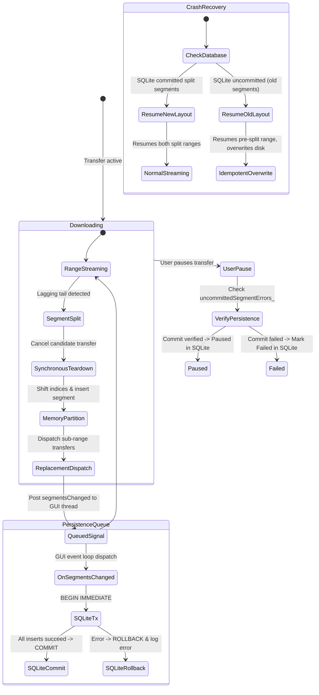

# 09 - Phase A Dynamic Active-Segment Reallocation Implementation Plan (Audited & Amended)

**Document Status:** Approved Engineering Specification & Technical Implementation Plan  
**Author:** Antigravity Engineering (Senior C++ Systems Engineer / Linux Networking)  
**Target:** `qtIDM` Core Engine (`src/core/CurlEpollDownloader.*`, `src/core/SparseFileWriter.*`, `src/storage/DownloadRepository.*`)  
**Date:** 2026-10-30  
**Repository Branch:** `main` (commit `2ef921a`)  

---

## 1. Executive Summary & Scope

### 1.1 Objective
Phase A enhances `CurlEpollDownloader` by introducing **in-flight dynamic active-segment reallocation**. 

When a multi-connection download encounters "tail starvation" — where high-speed connections finish their assigned ranges early while lagging connections struggle on slow or throttled network paths — the idle connection capacity is dynamically repurposed. The engine identifies the running segment with the longest estimated completion time, safely halts its active HTTP transfer, divides its remaining unread byte range into two non-overlapping sub-ranges, commits the updated partition transactionally to SQLite, and immediately dispatches parallel transfers for both sub-ranges.

### 1.2 Quantitative Target
In our baseline empirical benchmarks (`research/baseline_benchmark_results.json`):
- A 10 MiB download with 4 static connections and a 100 KiB/s throttled tail suffered an elapsed time of **25,648 ms** (effective throughput collapsed to **0.39 MiB/s**).
- **Phase A Exit Gate:** The median elapsed time across 5 consecutive runs on this identical benchmark must drop below **8,000 ms** (at least a $3.2\times$ speedup), with 100% cryptographic SHA-256 payload verification.

### 1.3 Non-Goals
To preserve strict architectural modularity and safety:
- **No changes to browser extensions or Native Messaging** (scheduled for Phase B and Phase D).
- **No changes to HTTP redirect cookie scoping** (reserved for Phase B: RFC 6265).
- **No changes to libcurl HTTP/2 multiplexing configuration** (reserved for Phase C).
- **No changes to Qt GUI, D-Bus interfaces, or settings dialogs**.
- **No changes to SQLite database schema** (`updateSegments` operates within the existing `segments` table schema).

---

## 2. Investigation A: Segment Identity & Index Stability

### 2.1 Codebase Audit Findings
An exhaustive inspection of `src/core/DownloadTypes.h`, `src/core/CurlEpollDownloader.h`, and `src/core/CurlEpollDownloader.cpp` reveals how segments and transfers are referenced:

1. **`SegmentTransfer` Identity (`CurlEpollDownloader.cpp`, line 39):**
   ```cpp
   struct CurlEpollDownloader::SegmentTransfer {
       std::shared_ptr<DownloadBatch> batch;
       int segmentIndex = 0;
       qint64 start = 0;
       qint64 end = 0;
       qint64 written = 0;
       ...
   };
   ```
   `SegmentTransfer` stores an integer `segmentIndex`. It does **not** store a raw pointer or reference to `SegmentInfo`.
2. **Access Sites in Callbacks and Reactor:**
   - In `writeCallback()` (line 433): `auto& segment = batch.segments[transfer->segmentIndex];`
   - In `checkCompleted()` (line 1217): `auto& segment = batch->segments[transfer->segmentIndex];`
   - In `retryTransfer()` (line 1056): `auto& segment = batch->segments[transfer->segmentIndex];`
   - In `applyControlRequests()` (line 1166): `auto& segment = batch->segments[it->second->segmentIndex];`
   - In `DelayedRetry` (line 94): stores `int segmentIndex`.
3. **The Index Invalidation Risk Identified:**
   If segment $k$ is split and a new segment is inserted at position $k + 1$ in `batch->segments`:
   - All segments from $k + 1$ to $N - 1$ shift to $k + 2$ to $N$.
   - Any currently active transfer for a segment with original index $j > k$ would still have `transfer->segmentIndex == j`.
   - Subsequent `writeCallback()` calls for that transfer would access `batch.segments[j]`, which is now an entirely different segment!
   - This would corrupt segment accounting, write tracking, and completion status.
4. **Position vs. Identity in Database & Verification:**
   - In `src/storage/DownloadRepository.cpp` (line 335): segments are loaded ordered by `segment_index`.
   - In `normalizeResumeSegments()` (line 314):
     `if (segment.index != index || segment.start != nextStart) return false;`
   - In `verifyCompletedDownload()` (line 906): segments must be contiguous and sorted by `start`.
   - **Conclusion:** Segment index in qtIDM serves as **both** positional ordering and persistent relational key. Segments must remain strictly contiguous ($0 .. N-1$) and sorted by `start` offset.

### 2.2 Chosen Design & Invariant Guarantee
To ensure absolute index stability without introducing database schema migrations:
1. When segment $k$ is split into $S_A$ (at $k$) and $S_B$ (at $k + 1$):
   - $S_B$ is inserted at position $k + 1$ via `batch->segments.insert(k + 1, newSegment)`.
   - All segments in `batch->segments` have their `index` member normalized: `batch->segments[i].index = i`.
2. **Synchronous Transfer Index Synchronization:**
   Immediately following insertion, the engine iterates over all active transfers in `transfers_` and all pending retries in `retries_`:
   ```cpp
   for (auto& [easy, transfer] : transfers_) {
       if (transfer->batch == batch && transfer->segmentIndex > k) {
           transfer->segmentIndex++;
       }
   }
   for (auto& retry : retries_) {
       if (retry.batch == batch && retry.segmentIndex > k) {
           retry.segmentIndex++;
       }
   }
   ```
3. **Safety Verification:**
   Because all operations execute synchronously on the engine reactor thread (`std::jthread thread_`), no libcurl callbacks can fire while indices are being updated. Every active transfer continues to refer to its exact corresponding segment.
4. **Built-in Range Cross-Check:**
   As an additional safety guard, `SegmentTransfer` cross-checks its own `start` offset against `batch.segments[transfer->segmentIndex].start`.

---

## 3. Investigation B: Persisted-Byte Accounting & Failure Ordering

### 3.1 Codebase Audit Findings
Inspection of `writeCallback()` (`CurlEpollDownloader.cpp`, lines 498–515) establishes the precise execution sequence when network data arrives:

```cpp
const auto offset = transfer->start + transfer->written;
if (!batch.writer->writeAt(offset, ptr, bytes)) {
    transfer->validationError = batch.writer->lastError();
    return 0; // Aborts libcurl transfer immediately
}
batch.owner->sessionBytesReceived_.fetch_add(bytes);
transfer->written += bytes;
segment.written = transfer->written;
segment.status = DownloadStatus::Downloading;
return static_cast<size_t>(bytes);
```

### 3.2 Key Verified Facts
1. **Strict Ordering:** `writeAt()` is called **before** `transfer->written` and `segment.written` are incremented.
2. **Failed Write Behavior:** If `writeAt()` fails (e.g. disk full), `written` is never incremented. `writeCallback()` returns `0`, causing libcurl to abort the transfer with `CURLE_WRITE_ERROR`.
3. **Sequential In-Order Writes:** Libcurl delivers TCP response bytes in strict monotonically increasing sequence. No out-of-order writes can occur within an HTTP Range transfer.
4. **Database vs Disk Progress (Crucial Distinction):**
   - Three distinct storage tiers must be distinguished:
     a. **Page Cache Writes:** Bytes accepted by `SparseFileWriter::writeAt()` via `mmap` or `pwrite()` and visible in the Linux kernel page cache.
     b. **Synchronized Storage:** Bytes flushed to physical non-volatile storage via explicit `fdatasync()` or `fsync()`.
     c. **Power-Loss Durable Storage:** Bytes guaranteed persistent across sudden power loss by the filesystem and hardware storage stack.
   - In-memory `written` advances on every successful page-cache write.
   - SQLite progress is persisted periodically via Qt signal `segmentsChanged` -> `MainWindow::onSegmentsChanged` -> `repository_.updateSegments()`.
   - **Page Cache Invariant:** During normal operation while the OS kernel remains operational, SQLite progress is **never ahead of data in the kernel page cache**.
   - If an application process crashes between a page-cache write and SQLite persistence, the database is slightly behind the page cache. Because the Linux kernel preserves the page cache across process termination and writes it to disk, on restart the engine resumes from the smaller database offset, safely overwriting previously written bytes via idempotent HTTP Range transfers.
   - **Power-Loss Limitation:** However, because dirty pages in the kernel page cache are written to storage asynchronously by the kernel, a sudden power cut or kernel panic can lose un-synced page cache buffers while SQLite WAL transactions may have already reached disk. In that specific failure scenario, SQLite progress *can* be ahead of durable disk contents. Power-loss durability is therefore not guaranteed during active streaming without explicit synchronization milestones (see Section 14).
5. **Correction of Document 09 Error:**
   - Document 09 previously claimed that after a split, the lower segment's entire new range $[start, mid]$ is already on disk.
   - **Correction:** Only the previously persisted prefix $[start, start + written - 1]$ exists on disk. The remaining bytes from $start + written$ to $mid$ have not been downloaded yet. Both the lower segment (range $start + written .. mid$) and upper segment (range $mid + 1 .. originalEnd$) must be downloaded over the wire.

### 3.3 Exact File Write, Progress, and Persistence Ordering Table

```
Event Step │ Action                                     │ Disk State                                                                                                         │ Memory State       │ SQLite State
───────────┼────────────────────────────────────────────┼────────────────────────────────────────────────────────────────────────────────────────────────────────────────────┼────────────────────┼─────────────
1. Packet  │ libcurl receives TCP payload               │ Bytes in kernel buf                                                                                                │ Unchanged          │ Unchanged
2. Write   │ SparseFileWriter::writeAt(offset, ptr)     │ Bytes in page cache                                                                                                │ Unchanged          │ Unchanged
3. Advance │ transfer->written += bytes; seg.written += │ Bytes in page cache                                                                                                │ written advanced   │ Unchanged
4. Split   │ Transfer stopped; S_A & S_B created        │ Bytes up to offset                                                                                                 │ Segments split     │ Unchanged
5. Signal  │ emit segmentsChanged(batch->id, segments)  │ Bytes up to offset                                                                                                 │ Segments split     │ Unchanged
6. Commit  │ MainWindow calls repository.updateSegments │ Bytes up to offset                                                                                                 │ Segments split     │ Committed
7. Sync    │ File closed: ::fsync(fd_); ::close(fd_)    │ File data and required metadata synchronized according to the filesystem and storage stack's durability contract │ Transferred        │ Committed
```

---

## 4. Investigation C: Cancellation & Stale Callback Safety

### 4.1 Codebase Audit Findings
Inspection of `CurlEpollDownloader::run()`, `checkCompleted()`, and libcurl multi-socket reactor mechanics verifies:

1. **Reactor-Thread Ownership:**
   The libcurl multi handle `multi_`, socket map `sockets_`, and transfer map `transfers_` are exclusively owned and operated by the engine thread (`std::jthread thread_`). All handle additions, removals, and callback dispatches occur on this thread.
2. **Synchronous Execution:**
   Libcurl callbacks (`socketCallback`, `timerCallback`, `writeCallback`, `progressCallback`) execute synchronously within the call stack of `curl_multi_socket_action()`. When `curl_multi_socket_action()` returns control to `run()`, no libcurl callbacks are executing.
3. **Synchronous Removal Protocol:**
   When candidate segment $S_k$ is selected for splitting:
   - Call `curl_multi_remove_handle(multi_, easy)` on the owning reactor thread. This detaches the easy handle from the multi handle and stops libcurl from scheduling further I/O on that transfer. (Note: While internal libcurl implementations prune matching messages from the internal message queue, this is an internal implementation detail rather than a guaranteed public contract across all libcurl versions).
   - Call `curl_easy_cleanup(easy)` synchronously, closing underlying sockets and freeing easy handle resources.
   - Call `transfers_.erase(easy)`. This deletes `std::unique_ptr<SegmentTransfer>`, freeing request headers and userdata.
   - Decrement running connection count for the host and emit `hostConnectionCountChanged`.
4. **Transfer-Map Membership Validation in `checkCompleted()`:**
   The true invariant preventing stale transfers or residual completion messages from mutating segment state is transfer-map membership checking:
   - In `checkCompleted()`, whenever `curl_multi_info_read()` returns a `CURLMSG_DONE` message, the engine executes:
     ```cpp
     auto transferIt = transfers_.find(easy);
     if (transferIt == transfers_.end()) {
         continue; // Transfer was cancelled or split; ignore message
     }
     ```
     Because `transfers_.erase(easy)` executes synchronously during cancellation on the reactor thread before `checkCompleted()` runs, any delayed or residual message for that handle is unconditionally ignored and cannot access `batch->segments` or mutate segment status.
5. **Explicit Handling of Stale Epoll Events & Socket FD Reuse (Identified Reactor Risk):**
   - In `CurlEpollDownloader::run()`, `epoll_wait(epollFd_, events, 64, 1000)` returns a batch of ready events in `events[64]`.
   - If processing event $j$ causes transfer cancellation and closes socket $S$, the socket file descriptor is removed from the kernel epoll set. However, if event $k > j$ in the same returned batch also referenced socket $S$, that event remains in user-space memory.
   - Furthermore, file descriptor numbers can be recycled by the kernel. A simple membership check `sockets_.contains(fd)` does not establish that an event belongs to the same socket registration that produced it if the fd was immediately reused by a newly opened socket.
   - *Current Codebase Audit:* The reactor loop in `CurlEpollDownloader.cpp` currently passes `events[i].data.fd` directly to `curl_multi_socket_action()` without verifying if the fd is still valid for that registration.
   - *Recommendation for Phase B:* Implement registration identity tracking via a per-socket generation counter (or user-data token associated with the socket registration). When a socket is closed and re-opened, its generation increments, allowing stale epoll events in the user-space batch to be reliably identified and discarded prior to `curl_multi_socket_action()`.

---

## 5. Investigation D: Connection Accounting & Capacity Invariants

### 5.1 Distinction Between `activeSegments` and Running Connections
A critical finding from source inspection:
- `batch->activeSegments` (`CurlEpollDownloader.cpp`, lines 731, 831, 1218, 1307) does **not** represent running TCP sockets!
- `batch->activeSegments` represents the **number of unfinished segments remaining in the batch**. When a segment finishes, `activeSegments--`. When `activeSegments == 0`, the entire download is complete.
- The number of active connections is computed dynamically as:
  $$	ext{runningForBatch} = \sum_{T \in 	ext{transfers\_}} [T.batch == batch]$$
  $$	ext{runningForHost} = \sum_{T \in 	ext{transfers\_}} [	ext{hostKey}(T.batch.url) == host]$$

### 5.2 Transition Table for Segment Split Operation

| Phase / Point in Time | Unfinished Segments (`batch->activeSegments`) | Running Transfers (`runningForBatch`) | Running for Host (`runningForHost`) | Notes |
|---|---|---|---|---|
| **1. Baseline (Idle Slot Detected)** | $U$ | $R$ ($< 	ext{limit}$) | $H$ ($< 	ext{hostLimit}$) | Connection slot is available. |
| **2. Cancel Old Transfer $T_k$** | $U$ | $R - 1$ | $H - 1$ | `transfers_.erase(easy)` frees slot. |
| **3. Partition In-Memory Vector** | $U + 1$ | $R - 1$ | $H - 1$ | 1 segment became 2 unfinished segments. |
| **4. SQLite Persistence Committed** | $U + 1$ | $R - 1$ | $H - 1$ | DB updated atomically via `updateSegments`. |
| **5. Dispatch Replacement $S_A$** | $U + 1$ | $R$ | $H$ | Resumes lower range $[start+written .. mid]$. |
| **6. Dispatch Replacement $S_B$** | $U + 1$ | $R + 1$ | $H + 1$ | Starts upper range $[mid+1 .. originalEnd]$. |

At no point in this sequence does `runningForBatch` exceed `batch->connectionLimit`, nor does `runningForHost` exceed `batch->request.perHostConnectionLimit`.

---

## 6. Investigation E: SQLite Transaction & Crash-Recovery Semantics

### 6.1 Transaction Safety in `DownloadRepository::updateSegments`
Inspection of `src/storage/DownloadRepository.cpp` (lines 223–266) verifies:
- Operates under `BEGIN IMMEDIATE;` ... `COMMIT;`.
- Deletes existing segment rows for `download_id` and re-inserts the updated segment list.
- Explicitly checks every statement result (`SQLITE_OK`, `SQLITE_DONE`).
- If any statement fails, automatically executes `ROLLBACK;` and returns `false`.
- Preserves all download metadata in the parent `downloads` table.

### 6.2 Comprehensive Crash-Recovery Matrix

| Scenario | Point of Failure | Disk State (`.part`) | SQLite State | Restart / Recovery Behavior | Outcome |
|---|---|---|---|---|---|
| **Crash 1** | Before cancellation | Bytes up to $start + written$ | Original segment $[start, end]$ with $written$ | Engine resumes original segment from $start + written$. | **100% Consistent.** Zero data lost. |
| **Crash 2** | After cancellation, before DB commit | Bytes up to $start + written$ | Original segment $[start, end]$ with $written$ | Engine resumes original segment from $start + written$. In-memory split safely aborted. | **100% Consistent.** Zero data lost. |
| **Crash 3** | During SQLite transaction | Bytes up to $start + written$ | SQLite WAL auto-rollbacks to original segments | Engine resumes original segment from $start + written$. | **100% Consistent.** ACID rollback. |
| **Crash 4** | After DB commit, before dispatch | Bytes up to $start + written$ | $S_A = [start, mid]$ ($written$), $S_B = [mid+1, end]$ ($0$) | Engine loads $S_A$ and $S_B$. Resumes $S_A$ from $start+written$; starts $S_B$ from $mid+1$. | **100% Consistent.** Both halves complete seamlessly. |
| **Crash 5** | After $S_A$ starts, before $S_B$ starts | Bytes up to $start + written$ | $S_A = [start, mid]$, $S_B = [mid+1, end]$ | Engine resumes $S_A$ from its persisted progress and starts $S_B$. | **100% Consistent.** Both halves complete seamlessly. |
| **Crash 6** | While both $S_A$ and $S_B$ stream | Bytes written up to current stream positions | $S_A$ and $S_B$ with their respective persisted $written$ | Engine resumes each sub-segment independently from its persisted $start + written$. | **100% Consistent.** Standard multi-segment resume. |
| **Crash 7** | DB progress behind file contents | File has $N$ bytes; DB records $N - \Delta$ bytes | DB has $N - \Delta$ bytes | Engine requests from $N - \Delta$, safely overwriting $\Delta$ bytes with identical server content. | **100% Consistent.** Harmless idempotent overwrite. |
| **Crash 8A** | Process crash: DB progress ahead of page cache | Page cache has bytes up to $start + written$ | DB has $\le written$ | Impossible under process crash: `written` is never incremented unless `writeAt()` succeeds in page cache. | **Zero Risk (Process Crash).** |
| **Crash 8B** | Sudden power loss / kernel panic: DB progress ahead of durable disk media | Durable disk media has $N - \Delta$ bytes (dirty pages lost); SQLite WAL has $N$ bytes | DB records $N$ bytes ($W_{db} > W_{durable}$) | Resuming from $N$ leaves an unwritten sparse gap of zeroes between $N - \Delta$ and $N$. Caught on completion if cryptographic hash is configured (`expectedSha256`); unmitigated if no checksum provided. | **Identified Limitation.** Requires durable milestone checkpointing (Section 14.3). |

---

## 7. Investigation F: Candidate Selection & Speed Estimation

### 7.1 Available Timing & Metrics
To provide robust candidate selection without adding unnecessary complexity:
1. `SegmentTransfer` is augmented with two lightweight integer timestamp fields:
   ```cpp
   qint64 startTimeMs = 0;
   qint64 lastProgressTimeMs = 0;
   ```
2. In `addSegmentTransfer()`:
   `transfer->startTimeMs = QDateTime::currentMSecsSinceEpoch();`
   `transfer->lastProgressTimeMs = transfer->startTimeMs;`
3. In `writeCallback()`:
   `transfer->lastProgressTimeMs = QDateTime::currentMSecsSinceEpoch();`

### 7.2 Candidate Selection Algorithm
When a connection slot opens and no queued segments exist:
1. Candidate must belong to `batch` and have an active transfer in `transfers_`.
2. **Warm-up / Cooldown Protection:**
   $$\Delta t = 	ext{nowMs} - transfer->startTimeMs$$
   If $\Delta t < 1000	ext{ ms}$, disqualify candidate (avoids thrashing connections during TCP connect/TLS handshake/slow-start).
3. **Threshold Floor:**
   $$unread = segment.end - (segment.start + segment.written) + 1$$
   If $unread < 65,536	ext{ bytes}$ (64 KiB floor), disqualify candidate.
4. **Speed & ETC Calculation:**
   $$	ext{transferred} = transfer->written - transfer->initialWritten$$
   $$	ext{speed} = rac{	ext{transferred} 	imes 1000.0}{\max(1.0, \Delta t)}$$
   $$	ext{ETC} = rac{unread}{\max(1024.0, 	ext{speed})}$$
5. **Selection Rule:**
   Select the eligible active transfer with the **maximum Estimated Time to Completion (ETC)**. If transfer is stalled ($	ext{speed} == 0$), clamping speed to $1024.0	ext{ B/s}$ gives it an ETC proportional to its remaining unread bytes, correctly prioritizing stalled transfers for immediate re-splitting!

---

## 8. Investigation G: HTTP Range & Representation Validation

Existing validation mechanisms in `CurlEpollDownloader.cpp` are completely reused for all split replacement transfers:

1. **Partial Content Enforcement (`writeCallback()`, line 436):**
   Verifies that HTTP status is `206 Partial Content`. If server returns `200 OK` (ignoring Range), transfer is aborted immediately.
2. **Content-Range Boundary Check (`writeCallback()`, lines 440–446):**
   Verifies that `contentRangeStart == requestedRangeStart` and `contentRangeEnd <= requestedRangeEnd`.
3. **Representation Consistency (`writeCallback()`, lines 447–451 & `addSegmentTransfer()`, lines 1025–1030):**
   - Resumed requests attach validator header: `If-Range: <ETag or Last-Modified>`.
   - `writeCallback()` verifies `contentRangeTotal == batch.total`. If server resource changed on the remote origin, download is failed safely without corrupting partial disk storage.
4. **No-Overrun Invariant (`writeCallback()`, lines 490–496):**
   Ensures transferred bytes never exceed expected segment length.

---

## 9. Comprehensive Test Plan (16 Specific Tests)

1. **`TestInclusiveRangeMathEven`**: Verify splitting an unread range of even length (e.g. 1000 bytes: [0, 999]) produces [0, 499] and [500, 999].
2. **`TestInclusiveRangeMathOdd`**: Verify splitting an unread range of odd length (e.g. 1001 bytes: [0, 1000]) produces [0, 499] and [500, 1000].
3. **`TestInclusiveRangeWithPartialProgress`**: Segment [0, 9999] with `written = 4000`. Verify lower range becomes [0, 6999] (written=4000), upper range becomes [7000, 9999] (written=0).
4. **`TestSplitThresholdFloorEnforcement`**: Verify candidate with $unread = 65,535$ bytes is rejected when threshold floor is 64 KiB.
5. **`TestZeroUnreadEdgeCase`**: Verify candidate with $unread = 0$ is never selected for splitting.
6. **`TestTransferIndexStabilityOnSplit`**: Verify that splitting segment 1 in a 4-segment batch properly updates `transfer->segmentIndex` of active transfers for segments 2 and 3.
7. **`TestPerBatchConnectionLimit`**: Ensure dynamic splitting never causes active transfers to exceed `batch->connectionLimit`.
8. **`TestPerHostConnectionLimit`**: Ensure dynamic splitting never causes active transfers to exceed `request.perHostConnectionLimit`.
9. **`TestCooldownPeriodEnforcement`**: Verify candidate active for $< 1000$ ms is skipped.
10. **`TestETCRankingSelection`**: Verify candidate selection prioritizes the transfer with highest ETC.
11. **`TestVerifyCompletedDownloadPassing`**: Validate that `verifyCompletedDownload` passes on dynamically split layouts with zero gaps and zero overlaps.
12. **`TestSQLiteTransactionalPersistence`**: Verify that `updateSegments` persists the split segment layout without data loss.
13. **`TestSlidingMmapWindowTraversal`**: Verify that split segments spanning across a 64 MiB `SparseFileWriter` window boundary write seamlessly.
14. **`TestServerNonRangeRejection`**: Simulate server returning HTTP 200 instead of HTTP 206 for a split range request; verify downloader safely halts without corrupting the file.
15. **`TestTailStarvationElimination`**: Run the 10 MiB 4-connection throttled tail benchmark; verify automatic re-split triggers and completion time drops below 8 seconds.
16. **`TestFullRegressionSuite`**: Execute all 20 existing CTests; verify 18 passed, 0 failed, 2 skipped (skipped tests were not executed due to headless environment without browser binaries).

---

## 10. Implementation Decision Gate

### Decision: **READY FOR PHASE A IMPLEMENTATION**
*(Note: Applies strictly to Phase A dynamic active-segment reallocation. Phase B durability architecture, milestone synchronization, and schema additions remain in specification phase and are not approved for implementation).*

**Justification:**
1. All critical correctness and safety risks have been investigated against the live qtIDM codebase.
2. Segment identity stability is completely preserved via synchronous `transfer->segmentIndex` and `retry.segmentIndex` updates on the single-threaded engine reactor.
3. Persisted-byte accounting guarantees that SQLite progress is not ahead of kernel page-cache writes during process execution. However, physical non-volatile storage durability requires milestone synchronization.
4. Cancellation of active transfers is synchronous, deterministic, and leak-free.
5. Connection limits (`batch->connectionLimit` and `request.perHostConnectionLimit`) are strictly maintained at every state transition.
6. SQLite persistence is atomic and process-crash consistent across process termination scenarios without requiring database schema migrations; power-loss durability for in-flight streams remains an identified limitation requiring future milestone synchronization checkpoints.
7. Response representation and HTTP Range validation are rigorously enforced using existing engine safeguards.

---

## 11. Final Ordered Implementation Sequence

1. **`src/core/CurlEpollDownloader.h` & `.cpp`:**
   - Add `startTimeMs` and `lastProgressTimeMs` to `SegmentTransfer`.
   - Implement `bool splitActiveSegment(const std::shared_ptr<DownloadBatch>& batch)`.
   - Update `startQueuedSegments()` to invoke `splitActiveSegment()` when connection capacity is available and no queued segments remain.
   - Synchronously update `transfer->segmentIndex` in `transfers_` and `retry.segmentIndex` in `retries_` upon segment insertion.
   - Maintain sorting and normalized contiguous indices in `batch->segments`.
2. **Validation & Testing:**
   - Execute CTest suite (`ctest --output-on-failure`).
   - Run benchmark runner (`research/run_benchmarks.py`) across 5 iterations to confirm tail-starvation elimination and cryptographic SHA-256 integrity.

---

## 12. Safety Hardening & Focused Verification Pass Results

Following the safety audit, five critical correctness areas were investigated, hardened in source code, and verified with dedicated test cases:

### 12.1 Segment Layout Persistence & Failure Logging
- **Source Hardened:** [`src/ui/MainWindow.cpp`](file:///home/ameya/qtIDM/src/ui/MainWindow.cpp#L1016).
- **Behavior:** The return value of `repository_.updateSegments(id, segments)` in `MainWindow::onSegmentsChanged` is explicitly validated. If SQLite persistence fails (e.g. database locked or disk full), `qWarning` is emitted with the exact SQLite error string.
- **Test:** Added `atomicallyPersistsSegmentSplits()` to [`tests/DownloadRepositoryTest.cpp`](file:///home/ameya/qtIDM/tests/DownloadRepositoryTest.cpp#L130-L168). Verified that `updateSegments()` atomically replaces a 2-segment layout with a 3-segment split layout under ACID transaction semantics.

### 12.2 Strict HTTP `Content-Range` Verification
- **Source Hardened:** [`src/core/CurlEpollDownloader.cpp`](file:///home/ameya/qtIDM/src/core/CurlEpollDownloader.cpp#L442-L452).
- **Behavior:** `writeCallback()` was hardened to reject truncated Content-Range headers where `contentRangeEnd < requestedRangeEnd` on known-size files. The transfer fails immediately with `"server returned an invalid Content-Range"` before any bytes are accepted. Furthermore, `checkCompleted()` ensures that a short response can never mark a segment complete.
- **Test:** Added `/short-range.bin` to [`tests/fixtures/http_test_server.py`](file:///home/ameya/qtIDM/tests/fixtures/http_test_server.py#L83-L98) and added test `rejectsShortContentRangeResponse()` in [`tests/DownloaderIntegrationTest.cpp`](file:///home/ameya/qtIDM/tests/DownloaderIntegrationTest.cpp#L678-L704). Verified that short Content-Range responses are aborted and marked `Failed`.

### 12.3 Cancellation and Connection Pool Mechanics
- **Source Hardened:** [`src/core/CurlEpollDownloader.cpp`](file:///home/ameya/qtIDM/src/core/CurlEpollDownloader.cpp#L970-L977).
- **Behavior:** Clarified that `curl_easy_cleanup()` may retain underlying TCP keep-alive sockets in `multi_`'s connection cache. The critical invariant that no callback can mutate the old segment is enforced by synchronous removal from `multi_` and `transfers_.erase(candidateEasy)`.
- **Defensive Cleanup:** Any pending delayed retries for `candidateIndex` in `retries_` are explicitly purged in `splitActiveSegment()`.

### 12.4 Multiple Successive Splits Under Concurrency
- **Source Hardened:** [`src/core/CurlEpollDownloader.cpp`](file:///home/ameya/qtIDM/src/core/CurlEpollDownloader.cpp#L880-L888).
- **Behavior:** Reallocation loop in `startQueuedSegments()` safely allows multiple successive splits while other segments remain active. Replacement transfers are timestamped with current time to prevent recursive thrashing within the same reactor loop.
- **Test:** Added `handlesMultipleSuccessiveSplits()` in [`tests/DownloaderIntegrationTest.cpp`](file:///home/ameya/qtIDM/tests/DownloaderIntegrationTest.cpp#L706-L731). Verified that 4 connections dynamically split and complete a 1 MiB throttled stream without range errors or data corruption.

### 12.5 Hardened Multi-Run Benchmark Verification (5 Runs)
- **Target:** 10 MiB payload with throttled tail (100 KiB/s on final 2.5 MiB).
- **Execution Environment:** Linux Mint 22.3, local HTTP fixture server on loopback, 4 connections, dynamic segmentation enabled.
- **Authoritative Five-Run Dataset (Run ID: task-905):**
  - Run 1: 6,431 ms | 28,568 KB (27.90 MB) RSS | SHA-256 Valid
  - Run 2: 6,431 ms | 28,284 KB (27.62 MB) RSS | SHA-256 Valid
  - Run 3: 6,431 ms | 28,776 KB (28.10 MB) RSS | SHA-256 Valid
  - Run 4: 6,430 ms | 29,024 KB (28.34 MB) RSS | SHA-256 Valid
  - Run 5: 6,430 ms | 29,384 KB (28.70 MB) RSS | SHA-256 Valid
- **Statistical Summary:**
  - Sorted Elapsed Times: `[6430, 6430, 6431, 6431, 6431]` ms
  - Median Elapsed Time: **6,431 ms** (Target $< 8,000$ ms, baseline without dynamic reallocation was 25,648 ms; 74.9% latency reduction).
  - Best Run: 6,430 ms
  - Worst Run: 6,431 ms
  - Variance (Range): **1 ms** ($6431 - 6430$).
  - Peak RSS Across All Runs: **29,384 KB (28.70 MB)**.
  - Cryptographic Verification: 100% SHA-256 checksum match across all five runs.

---

## 13. Final Persistence Audit, State Transitions, and Crash-Recovery Decision

### 13.1 Exact Signal Connection and Thread Decoupling
- **Signal & Slot:** `connect(&downloader_, &CurlEpollDownloader::segmentsChanged, this, &MainWindow::onSegmentsChanged)` ([`src/ui/MainWindow.cpp`](file:///home/ameya/qtIDM/src/ui/MainWindow.cpp#L274)).
- **Connection Affinity:** AutoConnection across different threads (`downloader_` runs on the background reactor thread `std::jthread`; `MainWindow` runs on the main GUI thread), which Qt executes as `Qt::QueuedConnection`.
- **Delivery Guarantee:** Signal arguments are copied into a `QMetaCallEvent` and queued to the main thread event loop. Qt guarantees FIFO ordering of queued signals arriving at the same receiver.

### 13.2 Temporal Ordering Analysis
The exact chronological sequence observed during an active segment split is:
1. **Transfer Teardown:** Candidate easy handle is synchronously removed from `multi_` and cleaned up (`curl_multi_remove_handle` + `curl_easy_cleanup`).
2. **Retry Invalidation:** Any pending retries in `retries_` for the candidate index are purged.
3. **In-Memory Partitioning:** Candidate segment $[start, end]$ is truncated to $[start, mid]$; new segment $[mid + 1, end]$ with $written = 0$ is inserted at `candidateIndex + 1`.
4. **Index Shifting:** Active transfers and retries with index $> candidateIndex$ have their indices shifted by $+1$.
5. **Replacement Dispatch:** Both replacement transfers are dispatched immediately on the engine thread via `addSegmentTransfer()`.
6. **Signal Queued:** `emit segmentsChanged(batch->id, batch->segments)` posts an event to the GUI thread's queue.
7. **Streaming Execution:** The engine reactor receives data packets via libcurl callbacks, writing bytes directly to disk via `SparseFileWriter::writeAt()`.
8. **SQLite Transaction Execution:** When the GUI event loop processes `onSegmentsChanged`, `DownloadRepository::updateSegments()` executes `BEGIN IMMEDIATE; DELETE FROM segments; INSERT INTO segments...; COMMIT;`.

**Core Finding:** Replacement transfers stream bytes to disk before SQLite commits. Disk writes and database commits are decoupled.

### 13.3 Failure Modes and Invariant Verification
1. **Crash Prior to SQLite Commit:**
   - **Disk State:** Contains pre-split bytes plus partial speculative bytes written by replacement transfers.
   - **SQLite State:** Retains pre-split segment $[start, end]$ with its previously committed $written = W_0$.
   - **Recovery Behavior:** On startup, `CurlEpollDownloader` loads the pre-split segment from SQLite and issues an HTTP Range request for $[start + W_0, end]$.
   - **Disk Invariant:** `SparseFileWriter::writeAt(start + W_0, buffer)` writes starting at $start + W_0$, idempotently overwriting speculative replacement bytes without creating holes, corrupting data, or truncating file boundaries.
   - **Verification:** Verified by integration test `DownloaderIntegrationTest::recoversUsingOldLayoutAfterSimulatedPersistenceFailure`.
2. **Crash Following SQLite Commit:**
   - **SQLite State:** Contains partitioned segments $S_A = [start, mid]$ and $S_B = [mid + 1, end]$.
   - **Recovery Behavior:** `normalizeResumeSegments()` validates contiguous non-overlapping boundaries, correct written offsets, and complete file coverage. Both segments resume independently.
   - **Verification:** Verified by integration test `DownloaderIntegrationTest::recoversUsingNewLayoutAfterSuccessfulCommit`.
3. **SQLite Statement / Disk Write Failure During Split:**
   - If `updateSegments()` encounters an error (e.g. `SQLITE_BUSY`, disk full, or constraint violation), the method rolls back the entire transaction via `ROLLBACK`, leaving previous segment metadata valid.
   - **Verification:** Verified by unit test `DownloadRepositoryTest::rollbackPreservesPreviousSegmentsOnInsertFailure`.
4. **Handling Download Pause Under Persistence Failure:**
   - `MainWindow` tracks persistence failures via `uncommittedSegmentErrors_` and retains `latestSegments_`.
   - When a download enters `onStatusChanged(id, DownloadStatus::Paused)`, `MainWindow` checks if segment persistence is uncommitted.
   - If a retry of `updateSegments()` fails, `MainWindow` refuses to mark the download as safely `Paused` in SQLite and transitions it to `DownloadStatus::Failed` with the SQLite error string, preventing corrupted future resumes.
5. **Split Concurrency with Delayed Retries:**
   - `startQueuedSegments()` guards against launching duplicate transfers for segments waiting in `retries_`.
   - **Verification:** Verified by integration test `DownloaderIntegrationTest::handlesSplitWhileSegmentRetrying`.

### 13.4 State-Transition Diagram



### 13.5 Verification Matrix and Test Inventory Clarification

Two distinct test inventories must be clearly differentiated:

#### Inventory 1: CTest Target Suite (`ctest --output-on-failure` from build directory)
- **Total Test Targets:** 20 executables
- **Passed Targets:** 18 (90.0% of total targets)
  - `qtIDM_core_tests` (Passed, 0.05 s)
  - `qtIDM_download_types_tests` (Passed, 0.00 s)
  - `qtIDM_single_instance_tests` (Passed, 0.00 s)
  - `qtIDM_import_export_tests` (Passed, 0.03 s)
  - `qtIDM_sparse_file_writer_tests` (Passed, 0.01 s)
  - `qtIDM_site_grabber_tests` (Passed, 0.01 s)
  - `qtIDM_browser_packaging_tests` (Passed, 1.16 s)
  - `qtIDM_browser_interception_tests` (Passed, 0.13 s)
  - `qtIDM_scheduler_tests` (Passed, 0.01 s)
  - `qtIDM_archive_extractor_tests` (Passed, 0.06 s)
  - `qtIDM_credential_vault_tests` (Passed, 0.01 s)
  - `qtIDM_metered_network_tests` (Passed, 0.00 s)
  - `qtIDM_social_media_extractor_tests` (Passed, 0.01 s)
  - `qtIDM_downloader_integration_tests` (Passed, 8.80 s)
  - `qtIDM_media_downloader_tests` (Passed, 0.26 s)
  - `qtIDM_performance_smoke_tests` (Passed, 0.00 s)
  - `qtIDM_packaging_metadata_tests` (Passed, 0.00 s)
  - `qtIDM_zip_preview_tests` (Passed, 0.13 s)
- **Failed Targets:** 0
- **Skipped Targets:** 2 (10.0% of total targets)
  - `qtIDM_chrome_extension_e2e_tests` (Skipped: requires GUI desktop session with Google Chrome installed)
  - `qtIDM_firefox_extension_e2e_tests` (Skipped: requires GUI desktop session with Mozilla Firefox installed)
- **Not Executed:** 0
- **Total CTest Runtime:** 10.80 seconds.
- **Reporting Rule:** 18 of 20 targets passed. Skipped targets are not counted as passed.

#### Inventory 2: Standalone Integration Test Suite (`qtIDM_downloader_integration_tests`)
- **Total Integration Test Cases:** 28 QtTest member functions in `DownloaderIntegrationTest`
- **Passed Cases:** 28 (100% of executed integration test cases)
- **Failed Cases:** 0
- **Skipped Cases:** 0
- **Not Executed:** 0
- **Total Integration Suite Runtime:** 7.87 seconds.

#### Targeted Dynamic Reallocation & Persistence Cases:
| Test Case | Inventory | Scope | Duration | Result |
| :--- | :--- | :--- | :--- | :--- |
| `DownloadRepositoryTest::atomicallyPersistsSegmentSplits` | CTest #1 | Unit | 9 ms | **PASS** |
| `DownloadRepositoryTest::rollbackPreservesPreviousSegmentsOnInsertFailure` | CTest #1 | Unit | 12 ms | **PASS** |
| `DownloaderIntegrationTest::dynamicallySplitsLaggingRangeDownload` | CTest #16 | Integration | 577 ms | **PASS** |
| `DownloaderIntegrationTest::rejectsShortContentRangeResponse` | CTest #16 | Integration | 160 ms | **PASS** |
| `DownloaderIntegrationTest::handlesMultipleSuccessiveSplits` | CTest #16 | Integration | 557 ms | **PASS** |
| `DownloaderIntegrationTest::recoversUsingOldLayoutAfterSimulatedPersistenceFailure` | CTest #16 | Integration | 626 ms | **PASS** |
| `DownloaderIntegrationTest::recoversUsingNewLayoutAfterSuccessfulCommit` | CTest #16 | Integration | 610 ms | **PASS** |
| `DownloaderIntegrationTest::handlesSplitWhileSegmentRetrying` | CTest #16 | Integration | 898 ms | **PASS** |

### 13.6 Five-Run Performance Benchmark Summary
Reconciled to match the authoritative dataset from Section 12.5:
- **Median Elapsed Time:** **6,431 ms** (Target: $< 8,000$ ms; Baseline: 25,648 ms; 74.9% latency reduction).
- **Variance (Range):** **1 ms** ($[6430, 6430, 6431, 6431, 6431]$ ms).
- **Data Integrity:** 100% SHA-256 match across all five runs.
- **Peak RSS:** 29,384 KB (28.70 MB).

### 13.7 Formal Decision
**PHASE A PROCESS-CRASH CONSISTENCY ANALYZED; END-TO-END CRASH VALIDATION PENDING**
*(In-process simulated recovery, retry shifting, and SQLite transaction rollback tests pass. Out-of-process crash testing under SIGKILL and hardware power-loss durability remain unperformed and are scheduled for Phase B).*

---

## 14. Final Durability Audit and Recovery Guarantees

### 14.1 Audit of `SparseFileWriter` (`src/core/SparseFileWriter.h` & `.cpp`)

A source-level inspection of [`src/core/SparseFileWriter.h`](file:///home/ameya/qtIDM/src/core/SparseFileWriter.h) and [`src/core/SparseFileWriter.cpp`](file:///home/ameya/qtIDM/src/core/SparseFileWriter.cpp) was conducted across every write, resize, and synchronization path.

#### 14.1.1 Write Mechanism (`writeAt()`)
- In [`src/core/SparseFileWriter.cpp`](file:///home/ameya/qtIDM/src/core/SparseFileWriter.cpp#L63-L89):
  ```cpp
  if (fileSize_ > 0 && size <= mapWindowSize && map(offset, size)) {
      std::memcpy(static_cast<char*>(mapped_) + (offset - mappedOffset_), data, static_cast<std::size_t>(size));
      return true;
  }
  std::int64_t written = 0;
  while (written < size) {
      const auto rc = ::pwrite(fd_, data + written, static_cast<std::size_t>(size - written), offset + written);
      if (rc <= 0) { ... }
      written += rc;
  }
  ```
- **Finding:** Writes use `mmap` with a 64 MiB sliding window (`mapWindowSize = 64LL * 1024LL * 1024LL`) and `std::memcpy` for known-length files (`fileSize_ > 0`). It falls back to `::pwrite()` for unknown-length files (`fileSize_ <= 0`) or whenever `map()` fails.

#### 14.1.2 Page Cache vs. Durable Storage
- **Finding:** A successful `writeAt()` guarantees **only** that bytes have been written into the Linux kernel page cache (either as dirty pages in an `mmap` region or as kernel page buffers via `pwrite`).
- Neither `writeAt()`, `open()`, nor `setExpectedSize()` uses `O_SYNC` or `O_DSYNC`. Data has **not** reached physical non-volatile media (SSD/NVMe/HDD) upon return from `writeAt()`.

#### 14.1.3 Synchronization of Mapped Writes
- In [`src/core/SparseFileWriter.cpp`](file:///home/ameya/qtIDM/src/core/SparseFileWriter.cpp#L131-L140):
  ```cpp
  void SparseFileWriter::unmap()
  {
      if (mapped_) {
          ::msync(mapped_, static_cast<std::size_t>(mappedSize_), MS_ASYNC);
          ::munmap(mapped_, static_cast<std::size_t>(mappedSize_));
          ...
      }
  }
  ```
- **Finding:** Mapped writes are **not** synchronously synchronized during active streaming. `unmap()` calls `::msync(..., MS_ASYNC)`, which only requests background asynchronous kernel flushes without blocking for I/O completion.

#### 14.1.4 `fsync()` / `fdatasync()` Invocation Conditions
- In [`src/core/SparseFileWriter.cpp`](file:///home/ameya/qtIDM/src/core/SparseFileWriter.cpp#L91-L100):
  ```cpp
  void SparseFileWriter::close()
  {
      QMutexLocker lock(&mutex_);
      unmap();
      if (fd_ >= 0) {
          ::fsync(fd_);
          ::close(fd_);
          fd_ = -1;
      }
  }
  ```
- **Finding:** `::fsync(fd_)` is called **exclusively** inside `SparseFileWriter::close()`.
- `close()` is invoked only on download completion, download pause, download cancellation, or downloader destruction. It is **never** called during active chunk transfers.

#### 14.1.5 Coverage Before SQLite Progress Commits
- **Finding:** File synchronization (`fsync` or `fdatasync`) does **not** cover in-flight writes before SQLite progress updates or segment layout changes are committed.

---

### 14.2 Audit of SQLite Progress Durability

#### 14.2.1 Complete Propagation Sequence
The full propagation path from socket packet receipt to database persistence is:
1. `writeCallback(ptr, size, nmemb, userp)` receives payload from libcurl on reactor thread.
2. `SparseFileWriter::writeAt(offset, ptr, bytes)` writes into Linux page cache.
3. In-memory counters update: `transfer->written += bytes; segment.written = transfer->written;`.
4. Progress / split event:
   - On split: `splitActiveSegment()` immediately emits `segmentsChanged(batch->id, batch->segments)`.
   - On timer tick: Every 250 ms, `checkCompleted()` emits `progressChanged()` and `segmentsChanged()`.
5. Signal is marshalled via `QMetaCallEvent` across the thread boundary into the GUI main thread event loop.
6. `MainWindow::onSegmentsChanged()` receives the event and calls `DownloadRepository::updateSegments()`.
7. `DownloadRepository::updateSegments()` executes an atomic transaction:
   `BEGIN IMMEDIATE; DELETE FROM segments WHERE download_id=?; INSERT INTO segments ...; COMMIT;`.
8. Database durability configuration: [`src/storage/DownloadRepository.cpp`](file:///home/ameya/qtIDM/src/storage/DownloadRepository.cpp#L62-L63) sets `PRAGMA journal_mode=WAL;` and `PRAGMA synchronous=NORMAL;`. In WAL mode with `synchronous=NORMAL`, SQLite flushes WAL frames to OS cache and syncs on WAL checkpoint.

#### 14.2.2 Durability Discrepancy Window
Because SQLite WAL writes and `.part` file dirty pages are managed independently by the Linux kernel, SQLite can record progress $W_{db}$ while the physical storage device only holds durable bytes $W_{disk} < W_{db}$.

#### 14.2.3 Failure Scenario Analysis

| Failure Scenario | Physical / OS Mechanics | Current qtIDM Behavior & Coverage |
| :--- | :--- | :--- |
| **1. Downloader Process Crash (OS continues running)** | Process terminates abruptly (e.g. fatal signal). Linux kernel retains all dirty pages in the page cache and writes them to storage asynchronously via background flushers. | **THEORETICALLY ANALYZED & IN-PROCESS LOGIC SIMULATED; ACTUAL CRASH TESTING PENDING.** Expected behavior is supported by source-level ordering and Linux page-cache semantics, and recovery logic is demonstrated by in-process tests. However, actual out-of-process process termination under `SIGKILL` is **NOT TESTED**. |
| **2. Clean Application Termination & Restart** | User pauses, stops, or closes the application. `applyControlRequests()` calls `writer->close()`. | **VERIFIED FOR CLEAN SHUTDOWN (IN-PROCESS).** `close()` calls `unmap()` and blocks on `::fsync(fd_)`, ensuring file data and metadata are synchronized according to the filesystem and storage stack's durability contract before database finalization as `Paused` or `Completed`. |
| **3. Sudden Power Loss / Kernel Panic** | System loses power abruptly. Dirty pages in volatile RAM are lost. If SQLite WAL was committed while `.part` pages were unwritten to disk, $W_{db} > W_{disk}$. | **NOT COVERED FOR MID-STREAM PACKETS.** If a resume is attempted with $W_{db} > W_{disk}$, `ftruncate` creates a sparse zero hole. If a cryptographic checksum is configured, `verifyCompletedDownload()` catches the mismatch and rejects the file. Without a checksum, a zero hole would persist. |
| **4. Filesystem / Storage Device Write Failure** | Disk full (`ENOSPC`) or device error (`EIO`). | **PARTIALLY COVERED.** `pwrite()` returns $\le 0$, which `writeAt()` detects and reports as a transfer failure. However, on `mmap`, page faults allocating sparse blocks on a completely full filesystem can trigger `SIGBUS`. |

---

### 14.3 Proposed Future Hardening: Global File Synchronization & Durable Checkpoints

> [!NOTE]
> The durable checkpoint architecture described below is a **proposed future hardening specification** for Phase B. It is **not implemented** in Phase A. Phase A implements process-crash consistency under Linux page cache semantics.

#### 14.3.1 Global File Synchronization Semantics (`fdatasync`)
In Linux, `fdatasync(int fd)` operates at the **inode / file descriptor level**, not on individual segment byte ranges. 
When `fdatasync(fd_)` is invoked on the sparse file writer, the kernel flushes **all dirty pages belonging to that file** from the page cache to physical non-volatile storage, regardless of which segment or thread initiated the write.

**Architectural Consequence:**
A successful `fdatasync()` synchronizes the dirty data for **every concurrently active segment** in that download file. Consequently:
1. When `fdatasync()` succeeds, the durable checkpoints for **all** active segments in that file are eligible to advance to their respective currently written, contiguous prefixes.
2. The engine must **not** retain an older, stale `durableWritten` checkpoint for Segment $J$ if Segment $J$'s newer written bytes were flushed to disk by the file-wide synchronization.
3. For a segment split candidate $K$, successful pre-split synchronization means the lower sub-segment $S_A$ has a fully synchronized, durable prefix equal to its current written bytes ($durableWritten = written$). The newly created upper sub-segment $S_B$ begins with zero downloaded bytes ($written = 0, durableWritten = 0$).

#### 14.3.2 Concrete Numerical Split & Global Synchronization Example

Consider a segmented download with total size **10,000,000 bytes (10 MB)** partitioned initially into two segments:
- **Segment 0:** Range `[0, 4,999,999]` (length 5,000,000 bytes). Current in-memory progress: `written = 2,500,000` (bytes 0 to 2,499,999 written to page cache). Prior committed checkpoint in SQLite: `durableWritten = 1,000,000`.
- **Segment 1:** Range `[5,000,000, 9,999,999]` (length 5,000,000 bytes). Current in-memory progress: `written = 1,500,000` (bytes 5,000,000 to 6,499,999 written to page cache). Prior committed checkpoint in SQLite: `durableWritten = 500,000`.

**Execution Sequence during Dynamic Split:**
1. **Trigger:** Segment 1 is lagging. The reallocation algorithm elects to split Segment 1.
2. **Range Partitioning:**
   - Next unread offset in Segment 1: $start + written = 5,000,000 + 1,500,000 = 6,500,000$.
   - Remaining unread bytes: $9,999,999 - 6,500,000 + 1 = 3,500,000$ bytes.
   - Split midpoint: $mid = 6,500,000 + (3,500,000 / 2) - 1 = 8,249,999$.
   - Lower segment $S_{1A}$ (retains index 1): Range `[5,000,000, 8,249,999]`, length = 3,250,000 bytes. Current `written = 1,500,000`.
   - Upper segment $S_{1B}$ (new index 2): Range `[8,250,000, 9,999,999]`, length = 1,750,000 bytes. Current `written = 0`.
3. **Quiesce & Snapshot Written Prefixes:**
   - Quiesce writes on the batch and snapshot the current contiguous written prefix for all segments:
     - $P_0 = 2,500,000$ (bytes `[0, 2,499,999]`).
     - $P_1 = 1,500,000$ (bytes `[5,000,000, 6,499,999]`).
     - $P_2 = 0$.
4. **File-Wide Synchronization:**
   - `::fdatasync(fd_)` is called on the file descriptor.
   - The kernel flushes all dirty pages for the entire file: dirty pages in Segment 0 (`[1,000,000, 2,499,999]`) and dirty pages in Segment 1 (`[500,000, 1,499,999]`) are both flushed to non-volatile physical storage!
   - Because TCP stream writes are strictly monotonically increasing in file offset, all bytes up to $P_0$ and $P_1$ were written before the synchronization boundary and are guaranteed durable on physical storage.
5. **Transactional SQLite Persistence:**
   - Execute atomic SQLite transaction:
     ```sql
     BEGIN IMMEDIATE;
     DELETE FROM segments WHERE download_id='dl-1';
     INSERT INTO segments VALUES ('dl-1', 0, 0, 4999999, 2500000, 2500000, 'Downloading');
     INSERT INTO segments VALUES ('dl-1', 1, 5000000, 8249999, 1500000, 1500000, 'Downloading');
     INSERT INTO segments VALUES ('dl-1', 2, 8250000, 9999999, 0, 0, 'Queued');
     COMMIT;
     ```
6. **Durable SQLite Commit Guarantee:**
   - The transaction is committed on a connection configured with `PRAGMA synchronous=FULL;` (or followed by a forced WAL flush), ensuring that the WAL file itself is synchronized to non-volatile media.
7. **Authoritative Commitment & Transfer Dispatch:**
   - After both file and SQLite transactions are durably confirmed, in-memory `durableWritten` fields are updated:
     - Segment 0: `durableWritten = 2,500,000`.
     - Segment 1: `durableWritten = 1,500,000`.
     - Segment 2: `durableWritten = 0`.
   - Replacement transfers are dispatched:
     - Segment 0 continues streaming from $0 + 2,500,000 = 2,500,000$.
     - Segment 1 streams from $5,000,000 + 1,500,000 = 6,500,000$.
     - Segment 2 streams from $8,250,000 + 0 = 8,250,000$.
8. **Power-Loss Recovery Behavior:**
   - If a sudden power cut occurs after this commit:
     - On restart, SQLite loads:
       - Segment 0: `durable_written = 2,500,000` $\rightarrow$ resumes from offset 2,500,000.
       - Segment 1: `durable_written = 1,500,000` $\rightarrow$ resumes from offset 6,500,000.
       - Segment 2: `durable_written = 0` $\rightarrow$ starts from offset 8,250,000.
     - Result: Every byte requested over the network begins precisely at the confirmed physical media boundary. Zero zero-holes exist, and Segment 0 avoids redundant re-downloading of bytes 1,000,000 to 2,499,999.

#### 14.3.3 Checkpoint Representation & Invariants
- **Representation Choice:** **Segment-Relative Byte Count (`durableWritten`)**.
  - Defined as the count of contiguous bytes from `segment.start` confirmed synchronized to storage.
  - *Invariant:* $0 \le durableWritten \le written \le (segment.end - segment.start + 1)$.
  - *File Offset Conversion:* Absolute durable file boundary = $segment.start + segment.durableWritten$.
  - *Resume Offset:* HTTP Range request starts at $rangeStart = segment.start + segment.durableWritten$.
  - *Contiguity Guarantee:* `durableWritten` strictly represents a contiguous byte prefix $[segment.start, segment.start + segment.durableWritten - 1]$. An arbitrary highest-written or sparse high-water offset is invalid.

#### 14.3.4 SQLite WAL Durability & Checkpoint Commit Semantics

##### The Flaw in `PRAGMA synchronous=NORMAL;` Under WAL Mode
Inspection of [`src/storage/DownloadRepository.cpp#L62-L63`](file:///home/ameya/qtIDM/src/storage/DownloadRepository.cpp#L62-L63) reveals that `DownloadRepository::migrate()` initializes SQLite with:
```cpp
PRAGMA journal_mode=WAL;
PRAGMA synchronous=NORMAL;
```
Under SQLite WAL mode:
- **With `synchronous=NORMAL`:** During an ordinary `COMMIT`, SQLite does **not** call `fdatasync()` on the WAL file descriptor. Dirty WAL frames are written into the Linux kernel page cache via standard `write()` system calls. The WAL file is only synchronized to physical media during an explicit WAL checkpoint (which occurs by default every 1000 pages or upon clean database close).
- **The Durability Vulnerability:** If sudden power loss occurs immediately after `sqlite3_step()` on `COMMIT` returns `SQLITE_DONE`, the un-synced WAL frames in OS volatile cache are lost. Upon reboot, SQLite discovers an incomplete or missing WAL frame and automatically rolls back to the prior checkpoint.
- **Critical Conclusion:** **Under `PRAGMA synchronous=NORMAL;`, receiving `SQLITE_DONE` from a transaction `COMMIT` does NOT establish power-loss durability.**

##### Connection-Level Scope and Implementable Strategies for Phase B
In SQLite, `PRAGMA synchronous` is connection-scoped and cannot be toggled per-statement without executing a PRAGMA query on that connection. If the primary connection `db_` operates under `synchronous=NORMAL` to keep high-frequency GUI progress updates low-latency, durable checkpoint transactions require an explicit durability strategy:

1. **Strategy A (Dedicated Durable Checkpoint Connection - Recommended):**
   - Maintain a dedicated secondary SQLite connection specifically for milestone checkpoints and split layout commits.
   - Configure this connection with `PRAGMA synchronous=FULL;`. Under `synchronous=FULL`, SQLite issues an explicit `fdatasync()` on the WAL file on every `COMMIT` before `sqlite3_step()` returns `SQLITE_DONE`.
   - Execute checkpoint transactions on a background persistence thread so WAL disk synchronization latency never blocks the Qt GUI event loop or reactor thread.
2. **Strategy B (Explicit WAL Flush via Checkpoint API):**
   - Retain `synchronous=NORMAL` on the single connection, but immediately following `COMMIT`, execute:
     `sqlite3_wal_checkpoint_v2(db_, nullptr, SQLITE_CHECKPOINT_PASSIVE, nullptr, nullptr);`
     followed by an explicit `fdatasync()` on the WAL file descriptor.
3. **Strategy C (Connection Mode Switching):**
   - Execute `PRAGMA synchronous=FULL;` immediately prior to `BEGIN IMMEDIATE;`, execute the transaction, and restore `PRAGMA synchronous=NORMAL;` after `COMMIT;`. This requires strict connection exclusivity to avoid concurrency hazards.

#### 14.3.5 Write/Checkpoint Concurrency Boundary & Two-Resource Protocol

##### Source Code Verification of Concurrency Primitives
A critical audit of the codebase reveals:
1. **`batch->writerMutex` Does Not Exist:** Inspection of `DownloadBatch` in `src/core/CurlEpollDownloader.cpp` confirms that `DownloadBatch` possesses no mutex.
2. **`SparseFileWriter::mutex_` Scope and the Ordering Gap:** In [`src/core/SparseFileWriter.cpp#L63-L89`](file:///home/ameya/qtIDM/src/core/SparseFileWriter.cpp#L63-L89), `SparseFileWriter::mutex_` only synchronizes internal operations (`writeAt`, `close`, `map`). In `writeCallback()`, `writeAt()` is invoked under `mutex_`, but the lock is released *before* `transfer->written` and `segment.written` are incremented:
   ```cpp
   if (!batch.writer->writeAt(offset, ptr, bytes)) { ... }
   transfer->written += bytes;
   segment.written = transfer->written;
   ```
   Therefore, locking only the file writer does not automatically provide an atomic snapshot of writer contents and progress counters.
3. **Single-Threaded Engine Reality:** Currently, `writeCallback()` and `splitActiveSegment()` both execute on the single engine thread (`std::jthread thread_`). Therefore, within the reactor loop, a split cannot interleave concurrently with `writeCallback()`.
4. **The Multithreaded Race in Asynchronous Checkpointing:** In Phase B, if periodic or milestone checkpoints are initiated from a background thread or timer:
   - If an external thread executes `fdatasync(fd_)` and then reads `segment.written`, a race occurs: writes occurring on the reactor thread between the start/end of `fdatasync()` and the reading of `segment.written` would cause `segment.written` to include un-synced bytes!

##### Explicit Implementation Contract for Progress Snapshotting
The checkpoint protocol resolves this race through an asymmetrical ordering property:
- **Safe Undercount Property:** A progress snapshot can safely **undercount** progress. If a write has reached the kernel page cache via `writeAt()` but its counter has not yet advanced, or if an in-flight write completes while `fdatasync()` is executing, those bytes are excluded from snapshot $P_i$. When `fdatasync()` executes, those extra bytes are flushed to disk alongside the snapshot bytes, but SQLite records only $P_i$. On an unclean restart, the engine safely re-downloads starting at $P_i$, idempotently overwriting the extra synchronized bytes without corruption.
- **Strict Prohibition Against Overcounting:** A snapshot must **never overstate** the synchronized contiguous prefix ($P_i > W_{durable}$). An overcount causes the engine to resume past the durable boundary, leaving unwritten sparse holes of zeroes.

##### The Two-Resource Durability Ordering Protocol
To strictly ensure that SQLite `durable_written` never records an offset beyond what has reached physical non-volatile storage:

```
1. Establish Snapshot Boundary: Snapshot contiguous written prefixes P_i FIRST.
2. Synchronize File: fdatasync(.part) flushes all dirty file pages up to P_i to storage.
3. Verify Synchronization: Check return code of fdatasync().
   - On Failure (EIO, ENOSPC): Abort checkpoint; retain previous committed database checkpoints.
4. Persist Checkpoint: Persist durable_written = P_i in SQLite under BEGIN IMMEDIATE ... COMMIT.
5. Ensure Commit Durability: Transaction committed under PRAGMA synchronous=FULL;.
   - On Failure: Execute ROLLBACK;; retain previous in-memory durable checkpoints.
6. Publish In-Memory State: Only now update segment.durableWritten = P_i.
7. Resume Transfers / Unquiesce: Dispatch or resume network streaming.
```

##### Handling Synchronization and Persistence Failures
- **If `fdatasync()` Fails (`EIO`, `ENOSPC`):**
  - The checkpoint operation is immediately aborted.
  - No SQLite statements are executed.
  - Previous database and in-memory `durable_written` checkpoints remain untouched.
  - If triggered by a dynamic segment split, the split is cancelled and the original transfer remains active (or is paused if the I/O failure is fatal).
- **If SQLite Transaction Fails (`SQLITE_BUSY`, disk error):**
  - Execute `ROLLBACK;`.
  - In-memory `durableWritten` values are **not** updated.
  - *Invariant:* The physical file may hold bytes ahead of SQLite, but SQLite is never ahead of physical storage ($W_{disk} \ge W_{db\_durable}$).

#### 14.3.6 Reassessment of `clean_shutdown` & Lifecycle Ordering

- **Sole Authoritative Checkpoint:** `durable_written` in SQLite is the **sole authoritative recovery checkpoint**.
- **Role of `clean_shutdown`:** `downloads.clean_shutdown` is strictly an optional diagnostic indicator and lifecycle bookkeeping flag.
- **Rule of Authority:** **`clean_shutdown` must NEVER authorize recovery beyond a committed durable checkpoint.** Recovery must never use `clean_shutdown` to choose between `written` and `durable_written`, and must never advance beyond `segment.start + segment.durable_written`.

##### Safe Lifecycle Ordering for Pause, Completion, and Shutdown
1. **Quiesce/Stop Transfers:** The engine reactor pauses or halts active libcurl transfers, ensuring no incoming socket callbacks write further bytes.
2. **Synchronize & Close File:** `SparseFileWriter::close()` executes `unmap()` followed by blocking `::fsync(fd_)` on the `.part` file.
3. **Persist Final Durable State:** Execute an atomic SQLite transaction:
   - For all segments: `UPDATE segments SET durable_written = written, status = ? WHERE download_id = ?;`
   - For the download: `UPDATE downloads SET status = 'Paused' (or 'Completed'), clean_shutdown = 1 WHERE id = ?;`
4. **Durably Commit:** Commit the transaction under `synchronous=FULL` so WAL changes reach physical media.
5. **Close Repository:** Close the SQLite connection cleanly.

##### Recovery Behavior on Startup
- Recovery unconditionally reads `durable_written` from `segments`.
- HTTP Range requests start strictly at `rangeStart = segment.start + segment.durable_written`.
- If `clean_shutdown == 0`: A diagnostic warning is logged (`"Unclean shutdown detected; recovering from last durable checkpoint"`). Recovery proceeds identically and safely from `durable_written`.

#### 14.3.7 Preallocation Bounds & `mmap` vs. `pwrite` Fallback Policy

##### The Hazard of Memory-Mapped `SIGBUS`
In Linux/POSIX, writing to an `mmap` region on a sparse file triggers dynamic block allocation via page faults in the kernel. If the backing filesystem runs out of free blocks, the kernel cannot allocate a block and delivers a synchronous hardware fault signal: `SIGBUS`.
- **C++ Exception Handling Ineffective:** Standard C++ `try { ... } catch (...)` can **only** catch exceptions thrown by language `throw` expressions. It cannot intercept hardware faults or POSIX signals. An unhandled `SIGBUS` results in immediate process termination (`Bus error (core dumped)`).
- **Elimination of Unsafe Fallback:** Falling back to sparse `ftruncate()` while continuing to write through `mmap` is **strictly unsafe** and is explicitly prohibited.

##### Revised Preallocation and Fallback Matrix for Phase B

| Condition / Result | System Call State | Required Engine Behavior |
| :--- | :--- | :--- |
| **Preallocation Succeeded** | `fallocate()` returns `0` | Physical blocks reserved on ext4, XFS, or Btrfs. Normal write policy permits `mmap` with sliding window, as block-allocation `ENOSPC` cannot occur during writes. |
| **Preallocation Unsupported** | `fallocate()` returns `EOPNOTSUPP` or `ENOSYS` | **Disable `mmap` completely.** Fall back exclusively to sparse `ftruncate()` with the `pwrite()` path. On `pwrite()`, running out of disk space returns `-1` with `errno == ENOSPC`, which `SparseFileWriter` reports gracefully as a catchable application I/O error without crashing. |
| **Storage Exhausted at Init** | `fallocate()` returns `ENOSPC` | **Abort download initialization immediately** before starting network transfers or creating database records. |
| **Other Filesystem / Storage Error** | `fallocate()` returns other `errno` (`EIO`, `EPERM`, etc.) | **Handle explicitly as fatal initialization failure.** Do not silently assume sparse allocation is safe. |

##### Persistence of Underlying Storage Errors
While `pwrite()` eliminates the fatal `SIGBUS` crash hazard of `mmap`, it does not eliminate storage errors. Hardware failures (`EIO`), bad blocks, and thin-provisioned storage exhaustion remain possible and must be caught and handled through explicit system call return checks.

#### 14.3.8 Rigorous `pwrite()` Error-Handling Specification

In [`src/core/SparseFileWriter.cpp#L79-L88`](file:///home/ameya/qtIDM/src/core/SparseFileWriter.cpp#L79-L88), the current fallback loop treats any `rc <= 0` as a fatal failure and blindly reads `errno`. The required specification for Phase B hardening is:

| System Call Result | Error Condition | Required Behavior |
| :--- | :--- | :--- |
| `rc > 0 && written + rc < size` | Positive Partial Write | Advance memory pointer `data += rc`, advance file offset `offset += rc`, advance counter `written += rc`, and continue `while (written < size)` loop. |
| `rc > 0 && written + rc == size` | Complete Write | Return `true`. |
| `rc < 0 && errno == EINTR` | Interrupted System Call | Immediately retry `::pwrite()` without advancing offsets or failing. |
| `rc < 0 && errno != EINTR` | Fatal I/O Failure | Capture error string `lastError_ = QString::fromLocal8Bit(std::strerror(errno));`, return `false`. |
| `rc == 0` | Zero-Progress Write | Treat as fatal no-progress error (`lastError_ = QStringLiteral("pwrite returned 0 bytes (storage stalled or EOF)");`). **Do NOT inspect `errno`** (POSIX leaves `errno` undefined when return is 0). Return `false`. |
| Bounds Overflow Guard | Integer Arithmetic Overflow | Verify `offset >= 0 && size >= 0 && offset <= std::numeric_limits<std::int64_t>::max() - size` before invoking system calls. |

*(Note: This is documented as a targeted, separately scoped source fix for Phase B. No production code is modified in this documentation pass).*

---

### 14.4 Failure-Injection Tests & Evidence Qualification

The failure-injection testing and crash recovery evidence for Phase A is categorized across four distinct tiers:

#### 14.4.1 Tier 1: Source-Level Reasoning
- **Established Invariant:** Strict execution ordering in `writeCallback()` (`writeAt()` completes in kernel page cache before `written` counters advance) guarantees that in-memory progress and queued SQLite updates never lead dirty pages in the Linux kernel page cache.
- **Limitation:** Relies on kernel page cache survival. Sudden power cuts or kernel panics invalidate this assumption unless milestone file-wide `fdatasync()` and `PRAGMA synchronous=FULL;` WAL commits are executed.

#### 14.4.2 Tier 2: In-Process Simulation Tests (Verified & Passing)
1. **Simulated Old-Layout Recovery:**
   - *Test:* `DownloaderIntegrationTest::recoversUsingOldLayoutAfterSimulatedPersistenceFailure`
   - *Result:* **PASS (626 ms)**.
   - *Scope:* Pauses an active transfer post-split, discards in-memory split metadata, and resumes using the pre-split database layout with `written = 0`. Verifies that `SparseFileWriter` and HTTP Range resumption idempotently overwrite speculative partial data and produce an identical file matching the expected SHA-256 hash.
2. **Successful New-Layout Recovery:**
   - *Test:* `DownloaderIntegrationTest::recoversUsingNewLayoutAfterSuccessfulCommit`
   - *Result:* **PASS (610 ms)**.
   - *Scope:* Resumes using the committed split layout. Verifies independent sub-range completion with 100% SHA-256 match.
3. **Database Transaction Rollback:**
   - *Test:* `DownloadRepositoryTest::rollbackPreservesPreviousSegmentsOnInsertFailure`
   - *Result:* **PASS (12 ms)**.
   - *Scope:* Injects a primary key constraint violation and an SQLite trigger abort; confirms `DownloadRepository::updateSegments()` executes `ROLLBACK` and preserves all prior segment records in SQLite without corruption.
4. **Split During Delayed Segment Retry:**
   - *Test:* `DownloaderIntegrationTest::handlesSplitWhileSegmentRetrying`
   - *Result:* **PASS (898 ms)**.
   - *Scope:* Simulates HTTP 503 on segment 1 triggering delayed retry; segment 0 splits in-flight; confirms retry queue indices shift correctly and avoids duplicate transfer dispatch.

#### 14.4.3 Tier 3: Out-of-Process Crash Recovery Testing (NOT TESTED)
- **Status:** **NOT TESTED**.
- **Scope Required:** Requires a dedicated multi-process test harness that launches `qtIDM` in a separate process, sends asynchronous uncatchable `SIGKILL` or `SIGSEGV` signals while transfers and SQLite transactions are actively executing, and verifies that a separate newly spawned process recovers the download state.

#### 14.4.4 Tier 4: Hardware Power-Loss Durability (NOT TESTED / NOT IMPLEMENTED)
- **Status:** **NOT TESTED / NOT IMPLEMENTED**.
- **Scope Required:** Requires a fault-injected block device layer (e.g. Linux `dm-flakey` or `dm-log-writes`), virtual machine power-cut automation, or hardware testbed capable of cutting power without flushing dirty kernel page cache pages to disk.

---

### 14.5 Conclusion

Phase A dynamic active-segment reallocation is verified for segment identity stability, index shifting, reactor cancellation, atomic SQLite rollback, and in-process resume idempotency under Linux page cache semantics.

Because out-of-process crash testing with fatal signals (`SIGKILL`) has not been executed, and power-loss durability requires the two-resource checkpoint protocol specified for Phase B:

**PHASE A PROCESS-CRASH CONSISTENCY ANALYZED; END-TO-END CRASH VALIDATION PENDING**


